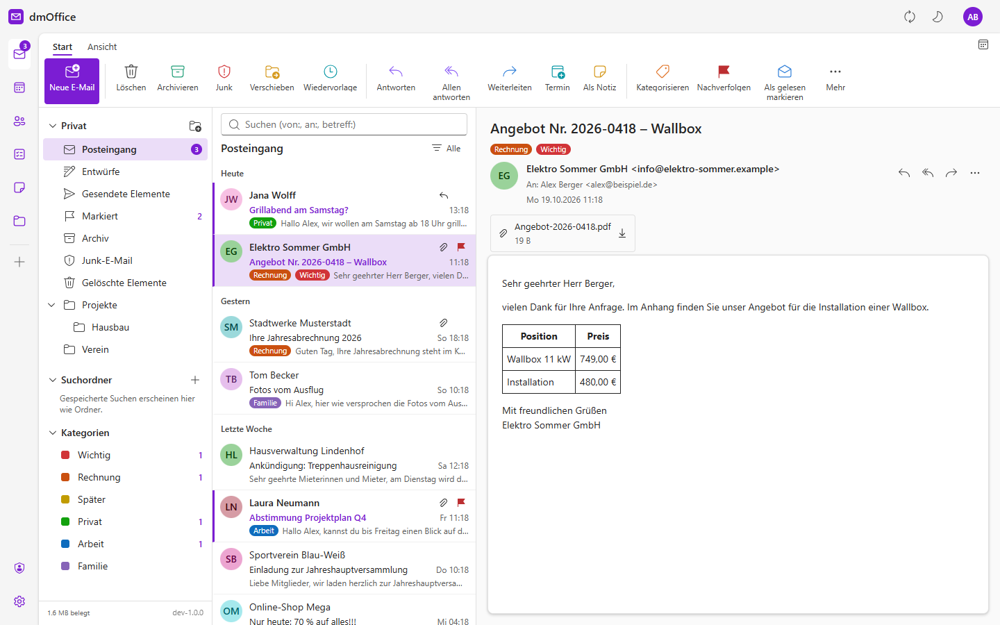

# dmOffice

Ein Büro im Browser, das sich bedient wie gängige Office-Programme – und ein eigener Server dazu:

| Bereich | Was es kann |
|---|---|
| **E-Mail** | IMAP/SMTP, beliebig viele Konten. Mit lokalem Speicher: je Konto *alles* oder *N Monate* zurück, vollständig samt Anhängen in der Datenbank. Volltextsuche (`von:`, `an:`, `betreff:`) über alle Ordner und Konten, Regeln (verschieben, kopieren, weiterleiten, markieren, löschen) und ein lernender Junk-Filter nach SpamBayes. Ziehen auf Ordner, gewohnte Tastenkürzel, Bilder aus dem Netz blockiert, Entwürfe |
| **Kalender** | Tag, Arbeitswoche, Woche, Monat, Liste; Serien (nur dieses / ganze Serie), Erinnerungen, mehrere farbige Kalender, Import/Export `.ics` |
| **Kontakte** | Adressbücher, Fotos, Adressvorschläge beim Schreiben, Import/Export `.vcf` |
| **Aufgaben** | Mein Tag, Wichtig, Geplant, Listen – als VTODO, also auch in jeder Aufgaben-App am Handy |
| **Notizen** | Die Notizen aus **notizi**, über dessen Ende-zu-Ende-verschlüsselten Abgleichordner. dmOffice ist ein weiteres Gerät wie das Handy |
| **Dateien** | Eigene Dateiablage per WebDAV und im Browser |
| **Server** | Eigener **CalDAV**-, **CardDAV**- und **WebDAV**-Dienst mit **App-Passwörtern** – ein zusätzlicher Cloud-Server ist nicht nötig |
| **Sicherheit** | Mehrere Benutzer, je Benutzer eine **verschlüsselte Datenbank** (SQLCipher), Zwei-Faktor-Anmeldung (TOTP) mit Wiederherstellungscodes |
| **Darstellung** | Hell, dunkel oder wie das System |

**Handbuch mit Bildern:** [Deutsch](docs/handbuch.md) · [English](docs/manual.md)



## Aufbau

```
DmOffice.Server/        ASP.NET Core (net10.0) – API, Hintergrunddienste, DAV-Server
  Core/                 Benutzer, Hauptschlüssel, verschlüsselte Benutzerdatenbank, 2FA
  Mail/                 IMAP-Sync, lokaler Speicher, Suche, Regeln, Spamfilter, Senden
  Pim/                  Kalender, Aufgaben, Kontakte (Speicher und Web-API)
  Dav/                  CalDAV/CardDAV/WebDAV (RFC 4918, 4791, 6352, 6578), Dateien
  Notes/                notizi-Abgleich (Notizi.Core) über das eigene WebDAV
web/                    React + Fluent UI 9, FullCalendar
vendor/Notizi.Core/     Kopie aus notizi – tools/notizi-core-holen.ps1 aktualisiert sie
DmOffice.Tests/         Prüfungen, darunter notizi als zweites Gerät über HTTP
unraid/dmoffice.xml     Unraid-Vorlage (Community Applications), Icon dmoffice.png
ca_profile.xml          Profil für Community Applications
.github/workflows/      baut das Image nach ghcr.io/taloan/dmoffice
.gitea/workflows/       baut das Image in die Registry einer eigenen Gitea
```

### Daten und Schlüssel

```
/data/users.json        Anmeldenamen, Passwort-Hashes, eingepackte Datenbankschlüssel, 2FA
/data/users/<id>.db     SQLCipher – alles eines Benutzers: Einstellungen, Mails mit Anhängen,
                        Kalender, Kontakte, Dateien, Notizen, App-Passwörter (nur Hashes)
/data/keys/             Schlüssel für das Anmelde-Cookie
/data/master.key        nur, wenn DMOFFICE_MASTER_KEY fehlt
```

Jede Benutzerdatenbank hat einen eigenen Zufallsschlüssel. Diese Schlüssel sind mit dem **Hauptschlüssel**
eingepackt. Der kommt aus der Umgebungsvariable `DMOFFICE_MASTER_KEY`, in Unraid steht er maskiert in der Vorlage
auf dem USB-Stick, nicht in `appdata`. Wer `appdata` kopiert, kann damit nichts lesen. Fehlt die Variable, legt
dmOffice `master.key` im Datenverzeichnis an und warnt in der Verwaltung. Wird die Variable später gesetzt, packt
der nächste Start alle Schlüssel um und löscht die Datei.

**Hauptschlüssel verloren heißt Daten verloren.** Gut aufheben, etwa im Passwortmanager.

## Unraid

Das Image baut GitHub Actions bei jedem Push auf `master` nach `ghcr.io/taloan/dmoffice:latest`
(ein Tag `v1.2.3` ergibt zusätzlich `:1.2.3` und `:1.2`).

1. **Vorlage** – über *Apps* (Community Applications) nach `dmOffice` suchen. Solange die App dort noch nicht
   gelistet ist: `unraid/dmoffice.xml` auf den USB-Stick nach
   `config/plugins/dockerMan/templates-user/my-dmoffice.xml` legen und *Docker* → *Add Container* → *Template* `dmOffice`.
2. **Installieren** – `DMOFFICE_MASTER_KEY` setzen (`openssl rand -hex 32`), Port wählen (Vorgabe 8080), *Apply*.
3. **Einrichten** – `http://<unraid>:8080/` öffnen: Der erste Aufruf legt das Verwaltungskonto an.

### Image aus einer eigenen Gitea

`.gitea/workflows/docker.yml` baut dasselbe Image in die Container-Registry einer Gitea auf demselben Server;
Docker zieht es über `127.0.0.1`, weil eine Registry ohne https nur über localhost angenommen wird.

1. **Repo** – in der Gitea anlegen, Actions einschalten (*Einstellungen* → *Actions*).
2. **Runner** – ein `act_runner` mit Label `ubuntu-latest:docker://docker:cli` und dem Docker-Socket des Hosts.
3. **Token** – im Repo unter *Einstellungen* → *Actions* → *Geheimnisse* `REGISTRY_TOKEN` anlegen (Zugangstoken mit
   `write:package`).
4. **Bauen** – Push auf `master` oder *Actions* → `docker` → *Ausführen*. Danach steht das Paket `dmoffice` unter *Pakete*.
5. **Vorlage** – wie oben, aber unter *Repository* `127.0.0.1:<gitea-port>/<besitzer>/dmoffice:latest` eintragen.

### Von außen erreichbar

Für Handys unterwegs und den Windows-Explorer braucht es HTTPS. Am einfachsten über den vorhandenen Reverse-Proxy
(Nginx Proxy Manager, SWAG, Traefik) auf den Port von dmOffice. dmOffice wertet `X-Forwarded-Proto` und `X-Forwarded-Host` aus,
die Adressen unter *Einstellungen* → *Geräte & Sync* stimmen dann. Für die automatische Erkennung leitet dmOffice
`/.well-known/caldav` und `/.well-known/carddav` selbst weiter.

### Als PWA installieren

dmOffice ist eine installierbare Web-App (PWA): unter Windows, macOS, Linux, Android und iOS läuft es dann in einem eigenen
Fenster mit eigenem Symbol. In dmOffice unter *Einstellungen* → *Allgemein* → *Als PWA installieren* (Chrome, Edge, Android),
auf iPhone/iPad in Safari über *Teilen* → *Zum Home-Bildschirm*. Voraussetzung ist HTTPS (oder `localhost`). Statische Dateien
liegen danach im Gerät, Post und Termine kommen immer frisch vom Server; ohne Verbindung erscheint ein Hinweis. Nach einem
Update bietet die App „Neu laden“ an. Die Symbole zeichnet `python tools/pwa-icons.py`.

## Outlook.com, Hotmail und Live

Private Microsoft-Konten (`outlook.com`, `hotmail.*`, `live.*`, `msn.com`) nehmen für IMAP und SMTP kein Passwort mehr an,
nur OAuth2. dmOffice bringt dafür eine eigene App-Registrierung mit („dm Mailsuite“ – so heißt sie auf der Zustimmungsseite von Microsoft), es ist nichts einzurichten.

Wer lieber eine eigene Registrierung verwendet (etwa in einer Firma), legt sie im
[Entra-Portal](https://entra.microsoft.com) unter *App-Registrierungen* an: Kontotypen *Alle Konten von Entra ID-Mandanten
und persönliche Microsoft-Konten*, keine Umleitungs-URI, unter *Authentifizierung* **Öffentliche Clientflows zulassen**
auf *Ja*. Der Name darf keine Microsoft-Marken wie „Office“ oder „Outlook“ enthalten. Die *Anwendungs-ID (Client)* dann
als `DMOFFICE_MS_CLIENT_ID` setzen (Unraid: erweiterte Ansicht der Vorlage, Docker Compose: `.env`) und dmOffice neu
starten. `DMOFFICE_MS_CLIENT_ID=off` schaltet die Microsoft-Anmeldung ganz ab.

Danach erkennt *Einstellungen* → *Konto* → *Konto hinzufügen* die Adresse und zeigt **Mit Microsoft anmelden**: Code
kopieren, `microsoft.com/link` öffnen, Code eingeben, anmelden und den Zugriff erlauben. dmOffice wartet, prüft IMAP und
SMTP und legt das Konto an. Das Refresh-Token liegt wie die Passwörter anderer Konten in der verschlüsselten Datenbank
des Benutzers. Läuft es ab (etwa nach einer Passwortänderung bei Microsoft), im Konto auf **Neu anmelden** gehen.

## Geräte verbinden

In dmOffice unter *Einstellungen* → *Geräte & Sync* je Gerät ein **App-Passwort** erstellen. Dort stehen auch die Adressen.

| Programm | Einstellung |
|---|---|
| Android (DAVx⁵) | „Mit URL und Benutzername anmelden“, URL `https://<host>/dav/` |
| iPhone/iPad | Einstellungen → Kalender → Accounts → Andere → CalDAV; Server: nur der Hostname. Genauso CardDAV |
| Thunderbird | Kalender: CalDAV-Adresse; Adressbuch: CardDAV-Adresse |
| notizi | Einstellungen → Sync → Verbindung → WebDAV, Adresse `…/dav/files/<login>/notizisync/` |

### Von Nextcloud umziehen

1. In Nextcloud jeden Kalender als `.ics` und jedes Adressbuch als `.vcf` herunterladen.
2. In dmOffice im Kalender bzw. in den Kontakten über das Menü der Sammlung *Importieren*.
3. notizi auf jedem Gerät auf die neue WebDAV-Adresse umstellen. Das erste Gerät legt den Abgleichordner neu an
   (oder vorher den Ordner `notizisync` aus Nextcloud unter *Dateien* hochladen). In dmOffice unter *Einstellungen*
   → *Notizen* das E2EE-Passwort eintragen und die Datenbank wählen.

## Entwickeln

```bash
dotnet run --project DmOffice.Server
```

```bash
cd web && npm install && npm run dev
```

Vite läuft auf Port 5173 und leitet `/api` und `/dav` an den Server auf 5099 weiter (`dmOffice.code-workspace`
setzt Port und Datenverzeichnis). Ohne Variable `DMOFFICE_DATA` liegen die Daten unter `bin/…/data`.

Prüfungen:

```bash
dotnet test
```

`NotiziInteropTests` laufen gegen einen laufenden Server, wenn `DMOFFICE_IT_URL`, `DMOFFICE_IT_USER`,
`DMOFFICE_IT_TOKEN` und `DMOFFICE_IT_E2EE` gesetzt sind. `DevSeed` legt Beispielmails an (`DMOFFICE_SEED`,
`DMOFFICE_SEED_USER`). Die Bilder der Doku erzeugt `tools/docs/make.sh [de|en]` aus einer leeren Datenbank mit erfundenen Beispieldaten (braucht Edge oder Chrome). Unter Windows muss der Datenpfad kurz sein: Natives SQLite scheitert an Pfaden über 260 Zeichen.

## Grenzen

- Wiederholungen bearbeitet die Oberfläche als Täglich, Werktags, Wöchentlich, Zweiwöchentlich, Monatlich oder
  Jährlich. Andere Regeln aus anderen Programmen bleiben erhalten und werden angezeigt.
- Notizen: Bearbeitet werden Absätze und Listen. Tabellen, Bilder und Codeblöcke bleiben unverändert, wie auf
  dem Handy. notizi am PC nimmt eine Fassung sonst nicht an.
- vCard-Gruppen (`item1.EMAIL` mit `X-ABLabel` von Apple) verlieren beim Bearbeiten im Browser die Beschriftung.
  Der Wert bleibt.
- Sperren (WebDAV LOCK) werden bestätigt, aber nicht durchgesetzt. Schreiben ist ohnehin atomar.

## Lizenz

Copyright (C) 2026 Dirk Mertens

dmOffice ist freie Software: Sie steht unter der **GNU Affero General Public License, Version 3**
([LICENSE](LICENSE)). Sie dürfen dmOffice nutzen, verändern und weitergeben. Wer eine veränderte Fassung als
Dienst im Netz anbietet, muss deren Quelltext den Nutzern ebenfalls unter der AGPL zugänglich machen.
dmOffice wird ohne jede Gewährleistung bereitgestellt.

`vendor/Notizi.Core` stammt aus notizi desselben Autors und ist hier ebenfalls unter der AGPL-3.0 enthalten.
Die fremden Bibliotheken (MIT, Apache-2.0, ISC, BSD) und ihre Lizenzen stehen in
[THIRD-PARTY-NOTICES.md](THIRD-PARTY-NOTICES.md); alle sind mit der AGPL-3.0 vereinbar.
