# dmOffice – Handbuch

**Deutsch** · [English](manual.md) · Webseite mit Neuigkeiten und Anleitungen: [dmoffice.de](https://dmoffice.de)

dmOffice ist ein selbst gehostetes Büro im Browser: E-Mail, Kalender, Kontakte, Aufgaben, Notizen und Dateien in einer Oberfläche. Dazu kommt ein eigener CalDAV-, CardDAV- und WebDAV-Dienst, sodass Handy, Tablet und Thunderbird ihre Daten direkt von dmOffice holen. Eine Android-App und das Bearbeiten von Word-, Excel- und PowerPoint-Dateien im Browser runden es ab.

Die Bilder zeigen ein erfundenes Beispielkonto („Alex Berger“). Sie werden mit `tools/docs/make.sh` aus einer leeren Datenbank neu erzeugt.

**Inhalt**

1. [Installation und erster Start](#1-installation-und-erster-start)
2. [E-Mail](#2-e-mail)
3. [Kalender](#3-kalender)
4. [Kontakte](#4-kontakte)
5. [Aufgaben](#5-aufgaben)
6. [Notizen](#6-notizen)
7. [Dateien](#7-dateien)
8. [Mit anderen Benutzern teilen](#8-mit-anderen-benutzern-teilen)
9. [Office-Dateien im Browser bearbeiten](#9-office-dateien-im-browser-bearbeiten)
10. [Android-App](#10-android-app)
11. [Handy, Tablet und Thunderbird verbinden](#11-handy-tablet-und-thunderbird-verbinden)
12. [Einstellungen](#12-einstellungen)
13. [Sicherheit](#13-sicherheit)
14. [Verwaltung (Admin)](#14-verwaltung-admin)
15. [Sicherung und Umzug](#15-sicherung-und-umzug)
16. [Tastenkürzel](#16-tastenkürzel)
17. [Häufige Fragen](#17-häufige-fragen)

---

## 1. Installation und erster Start

dmOffice läuft als Docker-Container, gedacht für Unraid, geht aber auf jedem Docker-Host.

**Unraid**

1. Unter *Apps* nach **dmOffice** suchen und installieren. Ist die App dort noch nicht gelistet, siehe [README](../README.de.md#unraid).
2. In der Vorlage **DMOFFICE_MASTER_KEY** setzen – eine lange Zufallsfolge, z. B. aus `openssl rand -hex 32`. Diesen Schlüssel gut aufheben (Passwortmanager): **Ohne ihn lassen sich die Daten nicht mehr öffnen.**
3. Port wählen und *Apply*.

**Docker Compose**

```yaml
services:
  dmoffice:
    image: ghcr.io/taloan/dmoffice:latest
    ports: ["8080:8080"]
    volumes: ["./data:/data"]
    environment:
      DMOFFICE_MASTER_KEY: "<lange Zufallsfolge>"
      TZ: Europe/Berlin
    restart: unless-stopped
```

Alle Umgebungsvariablen (`DMOFFICE_BLOBS`, `DMOFFICE_MS_CLIENT_ID`, `DMOFFICE_TRUSTED_PROXIES` …) stehen im [README](../README.de.md#konfiguration).

**Erster Aufruf:** `http://<server>:8080/` öffnen. Beim allerersten Aufruf legt dmOffice das Verwaltungskonto an. Danach meldet man sich mit Anmeldename und Passwort an.

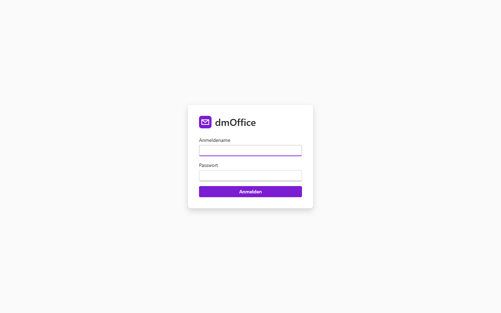

Für den Zugriff von unterwegs und für Handys gehört dmOffice hinter einen Reverse-Proxy mit HTTPS (Nginx Proxy Manager, SWAG, Traefik). Einige Browserfunktionen (Zwischenablage, Desktop-Benachrichtigungen, Installieren als App) gibt es nur über HTTPS.

**Als App installieren (PWA):** *Einstellungen* → *Allgemein* → *Als PWA installieren* (Chrome, Edge, Android) bzw. auf iPhone/iPad in Safari *Teilen* → *Zum Home-Bildschirm*. dmOffice läuft dann in einem eigenen Fenster mit eigenem Symbol.

---

## 2. E-Mail


Links stehen die **Favoriten** und die Ordner jedes Kontos, in der Mitte die Nachrichtenliste, rechts der Lesebereich und – wenn eingeschaltet – die **Aufgabenleiste** mit Kalender, Personen und Aufgaben.

### Konto einrichten

*Einstellungen* → *Konto* → *E-Mail-Konten* → *Konto hinzufügen*. Adresse eingeben: dmOffice sucht Server, Ports und die Art der Anmeldung selbst heraus, sonst IMAP- und SMTP-Server eintragen. Mit *Verbindung testen* prüfen. Outlook.com-, Hotmail- und Live-Konten melden sich bei Microsoft an (siehe [README](../README.de.md#outlookcom-hotmail-und-live)).

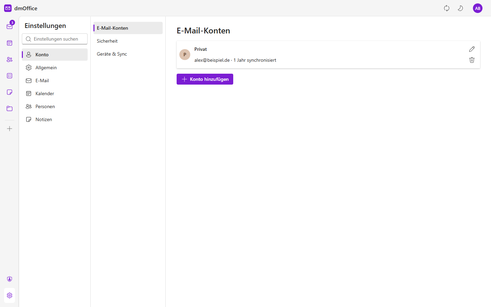

Je Konto lässt sich festlegen:

| Einstellung | Bedeutung |
|---|---|
| **Zeitraum** | *Alles* oder nur die letzten Monate liegen offline in dmOffice und sind durchsuchbar. |
| **Mails bis zu dieser Größe vollständig speichern** | Kleinere Mails kommen samt Anhängen in die Datenbank, größere werden beim Öffnen geholt. |
| **Gesendetes ablegen** | Bei Gmail aus – Gmail legt die Kopie selbst ab. |
| **Sprache der Mails** | Deutsch oder English: bestimmt *AW:/Re:*, *WG:/Fwd:*, den Zitatkopf und die Rechtschreibprüfung beim Antworten. |
| **Signatur** | Wird beim Verfassen unter den Text gesetzt. |

### Lesen, sortieren, ablegen

- **Ziehen** von Mails auf einen Ordner verschiebt sie, auf *Markiert* kennzeichnet sie.
- **Rechtsklick** auf eine oder mehrere Mails öffnet das Kontextmenü mit allen Aktionen.
- **Bilder aus dem Netz** sind blockiert, weil sie dem Absender verraten, dass die Mail gelesen wurde. Über *Bilder anzeigen ▾* lassen sie sich einmalig oder für den Absender bzw. die ganze Domain dauerhaft erlauben.
- **Suche** oben in der Liste: einfache Wörter oder gezielt `von:`, `an:`, `betreff:`. Mit *Alle Konten* über alle Konten hinweg.
- **Filter** über der Liste: Ungelesen, Gekennzeichnet, Mit Anhang oder eine Kategorie.

### Kategorien

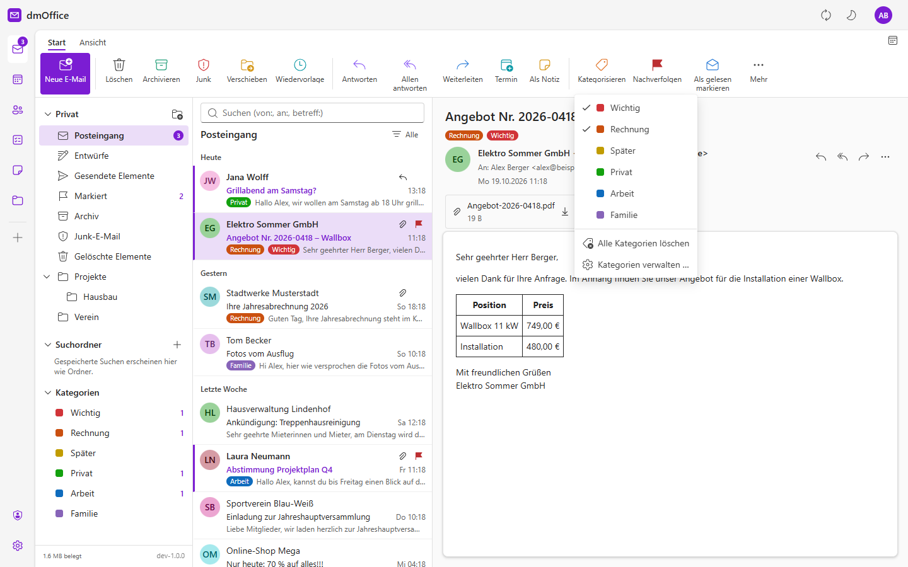

Kategorien sind farbige Schlagworte für Mails. dmOffice speichert sie als **IMAP-Schlagwort** auf dem Mailserver – sie sind also auch in Thunderbird oder auf einem zweiten dmOffice zu sehen, wenn dort dasselbe Schlagwort verwendet wird.

- *Kategorisieren ▾* im Menüband oder im Rechtsklick-Menü.
- Verwalten unter *Einstellungen* → *E-Mail* → *Kategorien*: Name, Farbe, Reihenfolge. Umbenennen ändert nur die Anzeige, die Mails behalten ihre Kategorie.
- Gmail nimmt keine eigenen Schlagworte an; dort meldet dmOffice das.

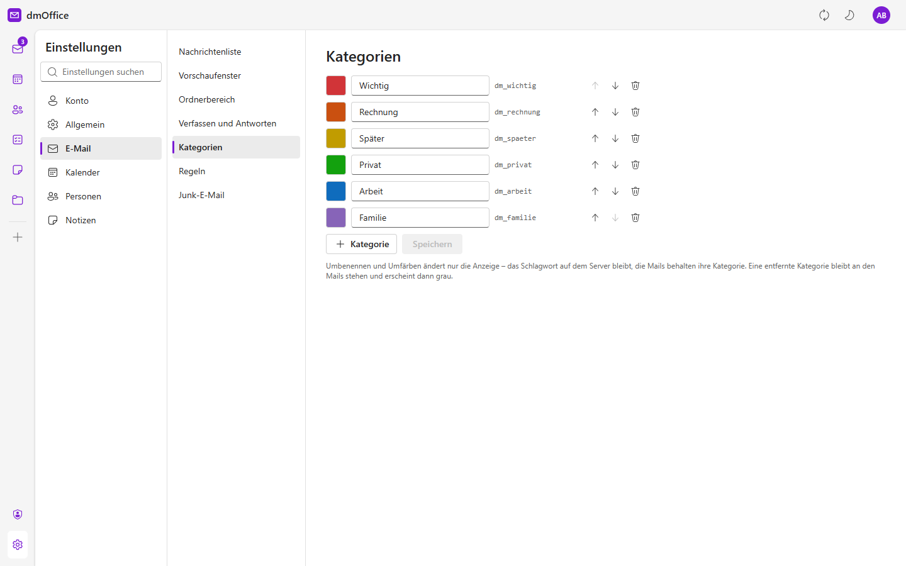

### Wiedervorlage

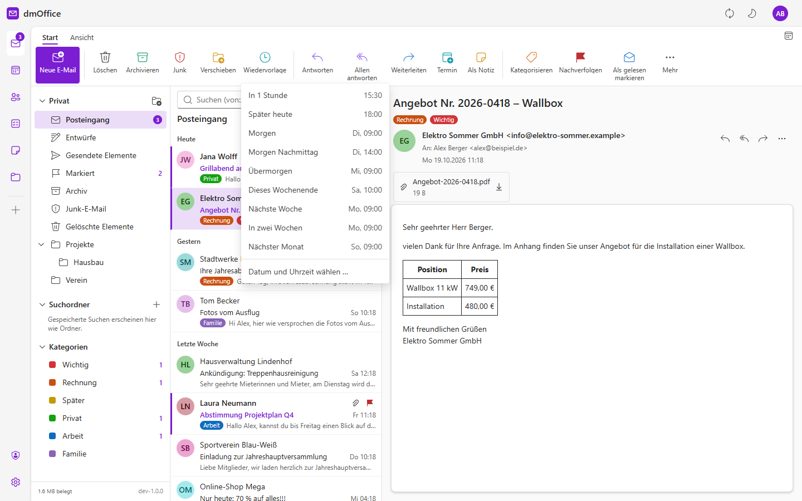

Eine Mail für später zurücklegen: *Wiedervorlage* → *In 1 Stunde*, *Heute Abend*, *Morgen*, *Nächste Woche* … oder ein eigenes Datum. Die Mail verschwindet in den Ordner *Wiedervorlage* und taucht zur gewählten Zeit **ungelesen oben im Posteingang** wieder auf. Mit *Wiedervorlage aufheben* kommt sie sofort zurück.

### Schreiben

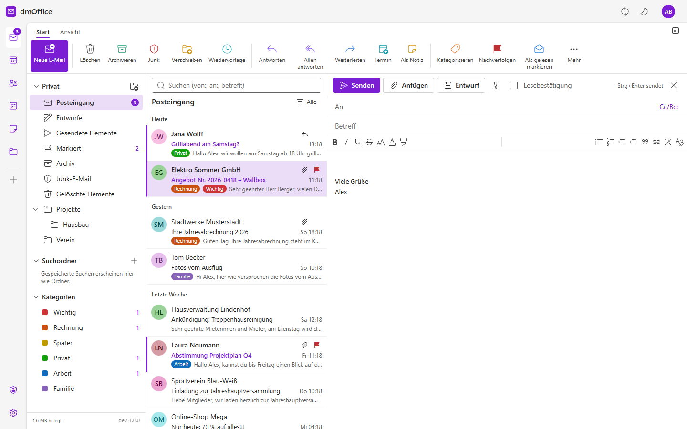

- *Neue E-Mail*, *Antworten*, *Allen antworten*, *Weiterleiten* oder *Als Anlage weiterleiten*.
- Empfänger werden beim Tippen aus Kontakten und früheren Adressen vorgeschlagen. Ein früherer Vorschlag lässt sich mit **×** vergessen; die Liste verwalten unter *Einstellungen* → *Personen*.
- Entwürfe werden automatisch gespeichert. **Strg+Enter** sendet.
- Ist im Text von einem Anhang die Rede, aber keiner dabei, fragt dmOffice nach.

### Mehr aus einer Mail machen

- **Termin aus E-Mail** – legt einen Termin mit Betreff und Text der Mail an.
- **Als Notiz speichern** – übernimmt die Mail in die Notizen. Oben in der Notiz steht ein Link *Mail in dmOffice öffnen*, der die Mail wieder aufruft – auch wenn sie inzwischen in einen anderen Ordner verschoben wurde.
- **Einladungen** – eine Termineinladung in einer Mail lässt sich direkt in der Mail zusagen, mit Vorbehalt zusagen oder absagen. Zugesagte Termine kommen in den Kalender, den man unter *Einstellungen* → *Kalender* → *Einladungen* wählt; steht der Termin schon in einem anderen Kalender, bleibt er dort.

### Regeln

*Einstellungen* → *E-Mail* → *Regeln*. Eine Regel prüft neue Mails im Posteingang (Absender, Empfänger, Betreff, Text, Kopfzeile) und kann verschieben, kopieren, weiterleiten, als gelesen markieren, kennzeichnen, eine Kategorie zuweisen oder löschen. Jede Mail durchläuft die Regeln **einmal** – auch wenn sie später wieder im Posteingang landet.

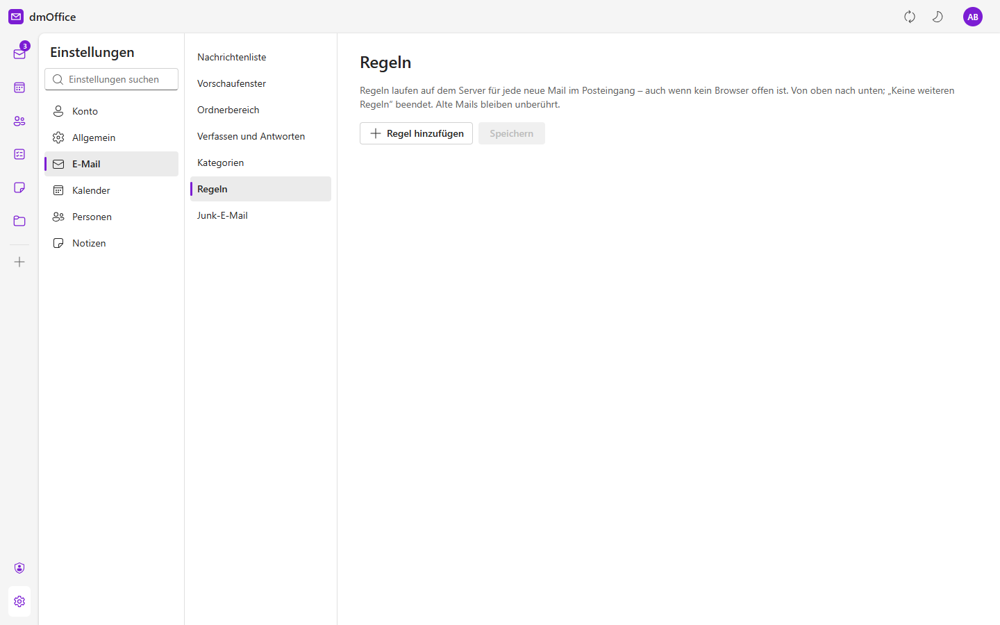

### Junk-E-Mail

Der Junk-Filter lernt mit einem statistischen Verfahren aus dem, was Sie als *Junk* oder *Kein Junk* markieren. Er bewertet und verschiebt erst, wenn er je 10 Mails beider Sorten gelernt hat; bis dahin bleibt alles im Posteingang. Schneller geht es mit *Aus Ordnern lernen*. Kontakte und Empfänger gesendeter Mails gelten als sichere Absender und landen nie im Junk. Einstellungen und Schwellen unter *Einstellungen* → *E-Mail* → *Junk-E-Mail*.

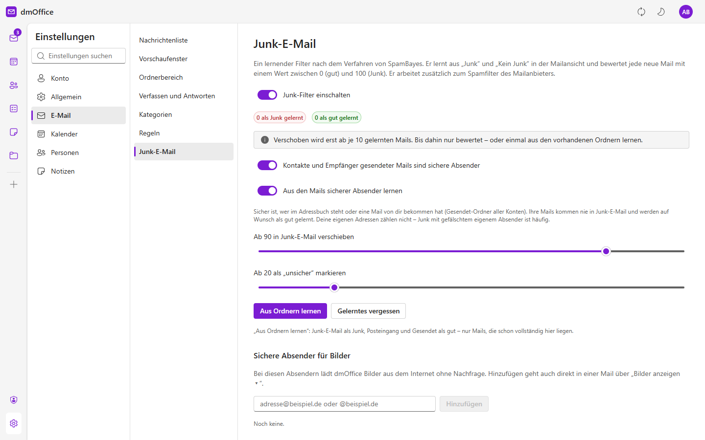

### Hell und dunkel

Oben rechts der Mond schaltet zwischen hell, dunkel und Systemeinstellung um.

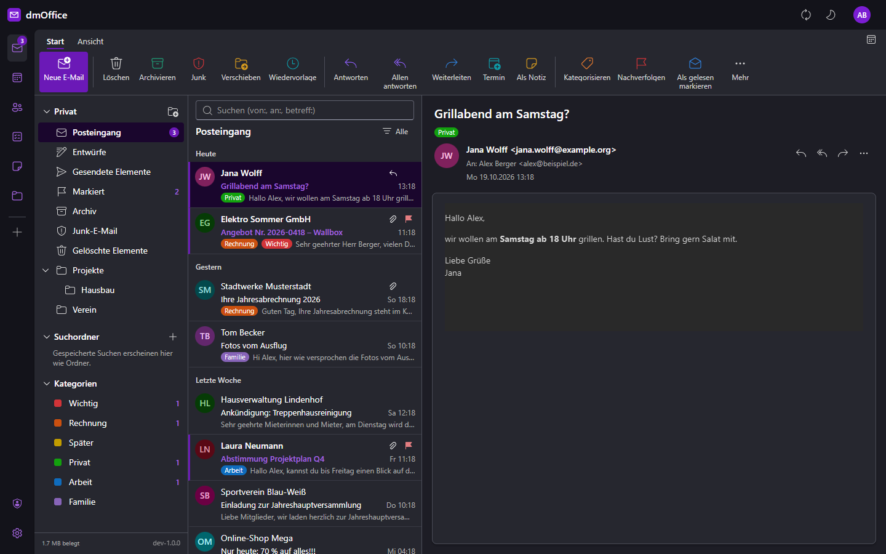

---

## 3. Kalender

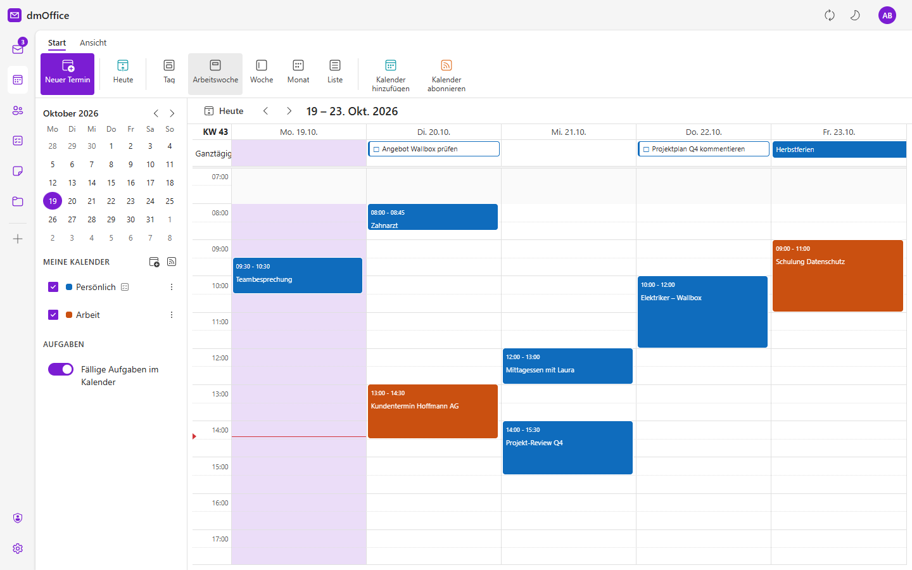

- Ansichten: Tag, Arbeitswoche, Woche, Monat, Liste.
- Mehrere farbige Kalender, einzeln ein- und ausblendbar.
- **Serien**: täglich, werktags, wöchentlich, zweiwöchentlich, monatlich, jährlich. Beim Ändern fragt dmOffice, ob nur dieser Termin oder die ganze Serie gemeint ist. Verschiebt man die ganze Serie, wandern abgesagte und geänderte Einzeltermine mit.
- **Erinnerungen** erscheinen als Hinweis im Browser (Benachrichtigungen erlauben) und auf allen verbundenen Geräten.
- **Import/Export** als `.ics` über das Menü des Kalenders – so ziehen Kalender aus anderen Programmen um.
- Wird ein Termin gleichzeitig am Handy geändert, warnt dmOffice beim Speichern, statt die Änderung zu überschreiben.

### Teilnehmer einladen

Im Termin-Editor nimmt *Teilnehmer einladen* Adressen oder Namen aus den Kontakten. Die Einladung geht per Mail von einem deiner Mailkonten aus – auch an Adressen außerhalb von dmOffice –, Antworten aktualisieren den Termin. Änderst du den Termin, lassen sich die Teilnehmer darüber informieren; beim Löschen bekommen sie eine Absage. Ohne Mailkonto werden Teilnehmer gespeichert, aber nicht benachrichtigt.

### Kalender abonnieren

*Kalender abonnieren* in der Kalenderliste nimmt eine `webcal://`- oder `https://`-Adresse (meist auf `.ics` endend) – z. B. Müllabfuhr, Feiertage, Schulferien oder einen freigegebenen Kalender eines anderen Anbieters. Ein Abo ist schreibgeschützt, wird regelmäßig neu geholt (stündlich bis wöchentlich, nach Wahl; *Jetzt aktualisieren* im Menü des Kalenders) und erscheint auch auf verbundenen Geräten.

### Kalenderarten und Essensplan

Jeder Kalender hat eine **Art**, einzustellen in seinen Eigenschaften. Neben *Normaler Kalender* gibt es *Essensplan*. Essensplan-Kalender erscheinen nicht in den normalen Kalenderansichten, sondern in einer eigenen Ansicht **Essensplan** (Menüband): eine Woche mit Frühstück, Mittagessen und Abendessen je Tag, aus allen eingeschalteten Essensplan-Kalendern, jeder Eintrag in der Farbe seines Kalenders. Man tippt ein, was es gibt, oder wählt ein Rezept aus den Notizen (Notizen mit der Rezeptvorlage von notizi). *Zutaten auf die Einkaufsliste* übernimmt die abgehakten Zutaten der Rezepte der Woche in eine Aufgabenliste. Einen Essensplan-Kalender teilt man mit der Familie (siehe [Abschnitt 8](#8-mit-anderen-benutzern-teilen)), dann planen alle dieselbe Woche.

---

## 4. Kontakte

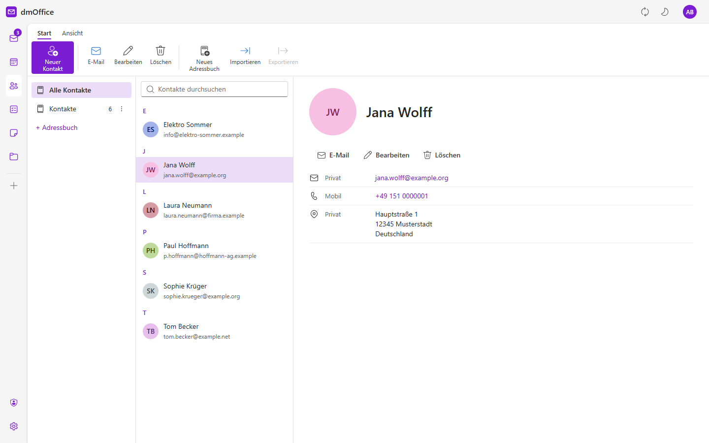

Adressbücher mit Fotos, mehreren Telefonnummern, Adressen und Geburtstagen. Felder, die dmOffice nicht selbst bearbeitet (z. B. Postfach oder zusätzliche Telefontypen vom iPhone), bleiben beim Speichern erhalten. Import und Export als `.vcf`.

---

## 5. Aufgaben

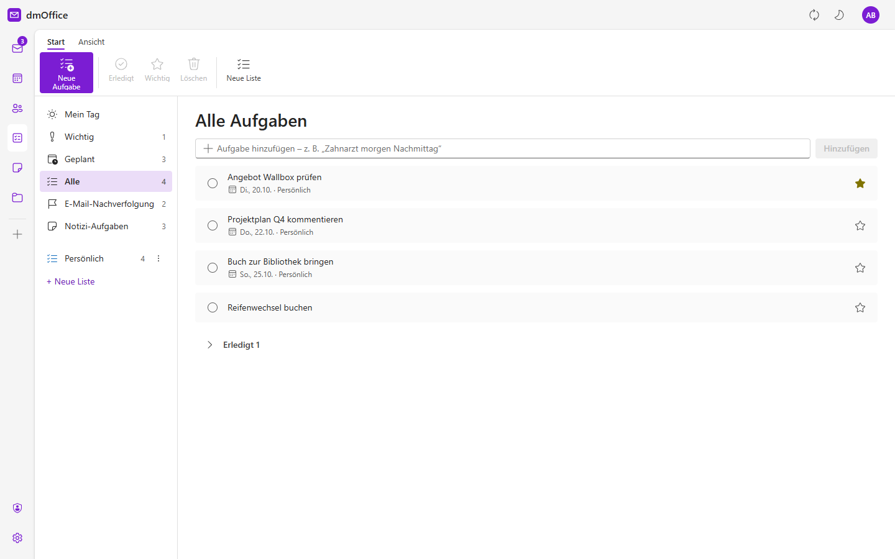

*Mein Tag*, *Wichtig*, *Geplant* und eigene Listen. Aufgaben sind VTODO-Einträge in einem Kalender und erscheinen damit in jeder Aufgaben-App, die CalDAV kann (z. B. jtx Board, OpenTasks, Erinnerungen am iPhone). Datum und Uhrzeit werden aus dem Text erkannt: „Zahnarzt morgen Nachmittag“ wird zur Aufgabe, die morgen Nachmittag fällig ist. Listen lassen sich mit anderen Benutzern teilen (siehe [Abschnitt 8](#8-mit-anderen-benutzern-teilen)); eine mit der Familie geteilte Einkaufsliste ist der typische Fall.

---

## 6. Notizen

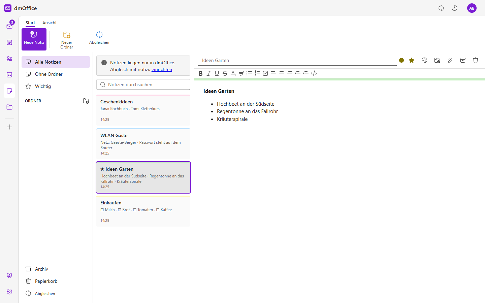

Notizen mit Farbe, Ordnern, Stern für *Wichtig*, Kästchen zum Abhaken, Listen, Codeblöcken und Anhängen. Bilder aus der Zwischenablage oder per Ziehen landen direkt im Text, andere Dateien als Anhang. Links öffnen mit Strg+Klick.

**Mit notizi:** dmOffice ist ein weiteres Gerät für die Notizen aus **notizi**. Der Abgleich läuft über den Ende-zu-Ende-verschlüsselten Abgleichordner von notizi, der im WebDAV von dmOffice liegt. Einrichten unter *Einstellungen* → *Notizen*: E2EE-Passwort eintragen und die Datenbank wählen.

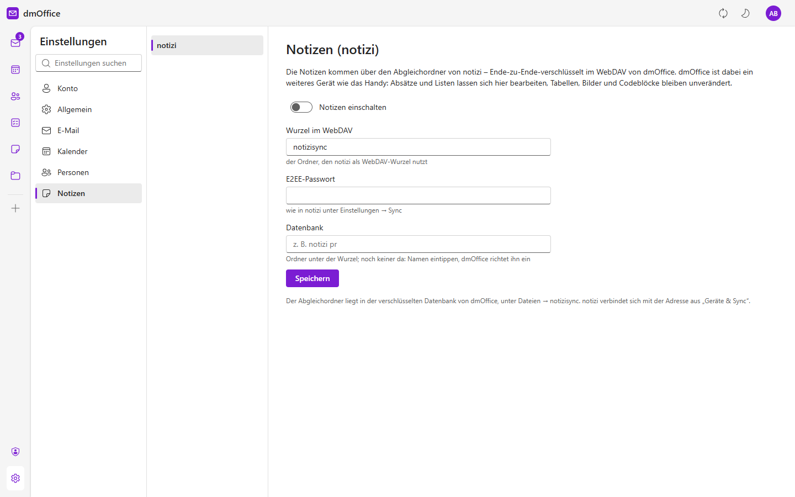

Tabellen und Bilder aus notizi werden angezeigt, aber nur am PC in notizi bearbeitet – sie sind in dmOffice gesperrt. Ändert ein anderes Gerät eine Notiz, während sie in dmOffice offen ist, warnt dmOffice und bietet *Als Kopie speichern* an.

Ohne notizi funktionieren die Notizen genauso, nur ohne Abgleich. Notizordner lassen sich mit anderen Benutzern teilen (siehe [Abschnitt 8](#8-mit-anderen-benutzern-teilen)).

---

## 7. Dateien

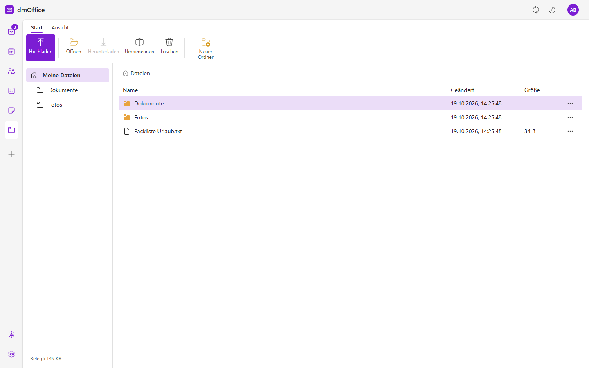

Eine eigene Dateiablage – im Browser und per WebDAV (Windows-Explorer, Finder, Dateimanager am Handy). Jede Datei wird einzeln verschlüsselt gespeichert.

**Arbeiten mit Dateien**

- Hochladen per Knopf oder Ziehen, auch ganze Ordner. Ordner lassen sich als ZIP herunterladen.
- Ansichten: Liste oder Kacheln, sortiert nach Name, Größe, Datum oder Typ, auf Wunsch gruppiert; ein Detailbereich zeigt die Eigenschaften der Auswahl samt Prüfsumme (Klick kopiert sie).
- Links: *Zuletzt verwendet*, *Favoriten*, *Fotos*, *Von mir geteilt*, *Mit mir geteilt* und der Papierkorb. Unten steht, wie viel belegt ist; hat der Admin eine Grenze gesetzt, zeigt ein Balken die Auslastung.
- Ausschneiden, Kopieren und Einfügen mit Strg+X/C/V, Umbenennen, Löschen und **Rückgängig** für die letzte Aktion. Gibt es den Namen am Ziel schon, fragt dmOffice: *Ersetzen*, *Beide behalten* oder *Überspringen* – auf Wunsch für alle weiteren Konflikte gleich.
- **Vorschau:** Bilder, PDFs, Audio, Video, Text und Markdown öffnen in einem Betrachter; Text- und Markdown-Dateien lassen sich dort auch bearbeiten. Vorschaubilder entstehen im Hintergrund.
- **Suche** sucht nach Namen und – sobald indiziert – im **Inhalt** von Dokumenten, PDFs und, mit Texterkennung (OCR), von Scans und Fotos. In diesem Ordner oder überall, filterbar nach Typ (Bild, Dokument, Tabelle, Präsentation, Audio, Video).

### Papierkorb

Gelöschte Dateien und Ordner kommen in den Papierkorb und lassen sich zurückholen (der ursprüngliche Ort steht dabei), bis er geleert wird. Unter *Einstellungen* → *Dateien* → *Papierkorb* legt man fest, nach wie vielen Tagen Einträge automatisch entfernt werden (Vorgabe 30; oder nie) und optional eine Speichergrenze; ist sie erreicht, fällt zuerst weg, was am längsten gelöscht ist.

### Frühere Versionen

Wird eine Datei überschrieben – im Browser, per WebDAV, vom Handy oder im Office-Editor –, bleibt der alte Inhalt als **frühere Version** erhalten. Datei auswählen und im Detailbereich *Frühere Versionen* öffnen, um eine wiederherzustellen (der jetzige Inhalt wird dabei selbst zur Version). Unter *Einstellungen* → *Dateien* → *Frühere Versionen* gibt es drei Arten: automatisch ausdünnen (aus den letzten 24 Stunden eine Version je Stunde, aus den letzten 30 Tagen eine je Tag, danach eine je Woche), eine feste Anzahl je Datei oder keine – dazu eine Speichergrenze für alle Versionen. Wird der Platz knapp, weichen zuerst die ältesten Versionen, dann der Papierkorb. Der Admin kann Obergrenzen für alle setzen.

### Freigabelinks

*Teilen* im Kontextmenü erzeugt einen Link, den jeder ohne Anmeldung öffnen kann. Man legt fest, was Besucher dürfen – ansehen, ansehen und herunterladen, ansehen und hochladen oder **nur hochladen** in einen Einwurf-Ordner, dessen Inhalt verborgen bleibt – und kann ein **Ablaufdatum**, ein **Passwort** und eine Obergrenze für Abrufe setzen. *Von mir geteilt* listet alle Freigaben; Links lassen sich jederzeit widerrufen. Vorgaben für neue Links stehen unter *Einstellungen* → *Dateien* → *Freigabelinks*. Ordner für andere Benutzer desselben Servers teilt man wie im nächsten Abschnitt.

### Prüfsummen und Duplikate

dmOffice hält zu jeder Datei eine SHA-256-Prüfsumme des Inhalts fest. Die Android-App erkennt damit, was schon gesichert ist, egal wo es liegt. Siehe [duplikate.de.md](duplikate.de.md).

---

## 8. Mit anderen Benutzern teilen

Kalender, Aufgabenlisten, Notizordner und Dateiordner lassen sich mit anderen Benutzern desselben Servers teilen. Der Besitzer legt je Person fest, ob sie **lesen** oder **bearbeiten** darf, und kann das jederzeit ändern oder entziehen.

- **Kalender und Aufgabenlisten:** *Teilen …* im Kontextmenü der Liste. Empfänger finden sie unter *Geteilt mit mir*. Mit *Bearbeiten* lassen sich Einträge hinzufügen, abhaken und ändern; nur lesend geteilte Kalender sind als solche gekennzeichnet.
- **Notizordner:** *Mit Personen teilen* am Ordner (samt Unterordnern). Änderungen sind sofort für alle sichtbar.
- **Dateiordner:** *Teilen* → *Mit Personen teilen* (über dem Link-Bereich). Empfänger bekommen oben in ihren Dateien einen virtuellen Ordner *Mit mir geteilt* – auch in WebDAV und den Nextcloud-Clients sichtbar. So lassen sich nur Ordner teilen; einzelne Dateien teilt man per Link.
- Empfänger können eine Freigabe ausblenden (*Nicht mehr anzeigen*); der Besitzer kann sie erneut teilen.

Das Geteilte **bleibt beim Besitzer**: nichts wird kopiert, es werden keine Schlüssel weitergegeben, der Server prüft die Freigabe bei jeder Anfrage – ein Entzug wirkt also sofort. Gelöschtes und frühere Versionen eines geteilten Ordners landen im Papierkorb des Besitzers, Uploads zählen auf dessen Speicher. Einzelheiten und Grenzen: [geteilte-kalender.de.md](geteilte-kalender.de.md), [geteilte-notizen.de.md](geteilte-notizen.de.md), [geteilte-ordner.de.md](geteilte-ordner.de.md).

---

## 9. Office-Dateien im Browser bearbeiten

Mit einem eigenen Office-Server öffnen Word-, Excel- und PowerPoint-Dateien (DOCX, XLSX, PPTX, auch ODT, ODS, ODP, RTF) direkt aus den *Dateien* zum Bearbeiten: Doppelklick oder *Im Browser bearbeiten* im Kontextmenü; *Neu* → *Word-Dokument / Excel-Arbeitsmappe / PowerPoint-Präsentation* legt eine leere Datei an und öffnet sie. Gespeichert wird über die Dateiablage, frühere Versionen, Papierkorb, Suche und Speichergrenzen gelten also wie sonst. Mehrere Personen können im selben Dokument arbeiten, auch in geteilten Ordnern (mit *Bearbeiten*-Recht).

Den Office-Server verbindet der Admin unter *Verwaltung* → *Office im Browser*. Empfohlen ist **Collabora Online (CODE)**, das auch auf dem Handy bearbeitet; ein vorhandener **ONLYOFFICE Docs** geht ebenso. Einrichtung, Reverse-Proxy-Beispiele und Fehlersuche: [office.de.md](office.de.md). Ohne Office-Server funktioniert die Dateiablage wie bisher.

---

## 10. Android-App

Die native Android-App (Android 8 und neuer) bringt dmOffice aufs Handy. Sie liegt nicht im Play Store, sondern als signierte APK bei den [GitHub-Releases](https://github.com/Taloan/dmOffice/releases) – in dmOffice zeigt *Einstellungen* → *Allgemein* → *Apps installieren* den Download und die Schritte. Die App sucht selbst nach Updates (bei GitHub, einmal am Tag und beim Start; die Signatur muss passen) und bietet sie zum Installieren an.

**Einrichten:** In dmOffice zeigt *Einstellungen* → *Konto* → *Geräte & Sync* → *Handy-App koppeln* einen QR-Code (er enthält ein neues App-Passwort und wird nur einmal angezeigt). In der App scannen oder Adresse, Anmeldename und App-Passwort von Hand eintragen. Der Verkehr zwischen App und Server steckt zusätzlich zu TLS in einem verschlüsselten Umschlag.

**Was sie kann**

- **Kalender und Aufgaben** mit Agenda, Tag, Woche und Monat, offline, mit Erinnerungen und drei **Widgets** für den Startbildschirm (Agenda, Aufgaben, Monat). Datum und Uhrzeit werden aus dem Text erkannt („Zahnarzt morgen 15 Uhr“).
- **Mail** mit Offline-Zwischenspeicher, Lesen, Antworten, Weiterleiten und Benachrichtigungen bei neuer Post, je Konto einstellbar. **Kontakte** und **Notizen**.
- **Dateien:** durchsuchen, Vorschau, umbenennen, löschen, frühere Versionen wiederherstellen und Freigabelinks erzeugen. Dateien oder Ordner als **Offline verfügbar** markieren – dann liegt eine Kopie auf dem Handy, die aktuell gehalten wird. Office-Dateien öffnen im Editor des Office-Servers.
- **Automatisches Hochladen:** Regeln laden neue Fotos, Videos oder andere Dateien aus einem Ordner des Handys (Kamera, Screenshots, WhatsApp-Medien oder ein beliebiger Ordner) in einen Ordner der dmOffice-Dateien, auf Wunsch nach Jahr, Monat oder Tag in Unterordner sortiert. Je Regel stellt man Dateitypen, den Umgang mit gleichnamigen Dateien (beide behalten, überspringen, ersetzen – die alte bleibt als frühere Version), nur WLAN, nur beim Laden oder auch im Roaming sowie das Startdatum ein. Neue Fotos werden binnen Sekunden bemerkt; eine Datei, deren Inhalt schon irgendwo in dmOffice liegt (gleiche Prüfsumme, auch von einem anderen Gerät), wird nicht noch einmal übertragen. Eine Warteschlange zeigt den Fortschritt, fehlgeschlagene Uploads lassen sich wiederholen.
- **Speicherplatz freigeben:** zeigt Fotos und Videos, die dmOffice als gesichert bestätigt hat (per Prüfsumme, und seitdem unverändert), und löscht sie auf Wunsch vom Handy. Kurz vor dem Löschen fragt die App den Server noch einmal; in dmOffice bleiben die Dateien. Die jüngsten Tage kann man auf dem Handy behalten.
- **Android-Kalender und -Kontakte:** auf Wunsch in Kalender und Kontakte des Handys gespiegelt, damit andere Apps sie sehen.
- **Sicherheit:** verschlüsselte lokale Datenbank, optionale App-Sperre per Fingerabdruck, Gesicht oder PIN.

Technik, Bauen und optionales Push: [apps/mobile/README.de.md](../apps/mobile/README.de.md).

---

## 11. Handy, Tablet und Thunderbird verbinden

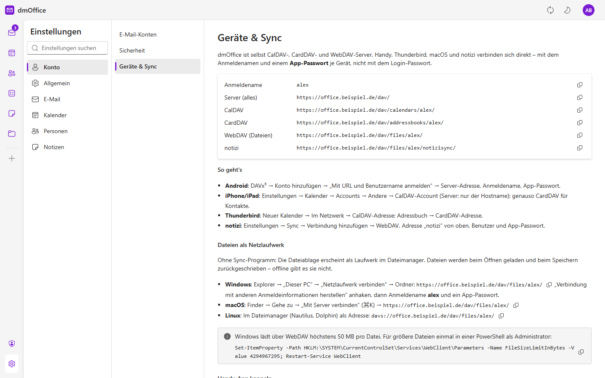

Unter *Einstellungen* → *Konto* → *Geräte & Sync* für **jedes Gerät ein eigenes App-Passwort** erstellen. Das Login-Passwort gilt für diese Programme bewusst nicht: Ein App-Passwort lässt sich einzeln widerrufen, wenn ein Gerät verloren geht.

| Programm | So geht's |
|---|---|
| **Android (DAVx⁵)** | *Mit URL und Benutzername anmelden*, URL `https://<host>/dav/`, Anmeldename, App-Passwort. |
| **iPhone/iPad** | *Einstellungen* → *Kalender* → *Accounts* → *Account hinzufügen* → *Andere* → *CalDAV-Account*; Server: nur der Hostname. Für Kontakte genauso mit *CardDAV-Account*. |
| **Thunderbird** | Neuer Kalender → *Im Netzwerk* → Adresse aus *Geräte & Sync*. Adressbuch: *CardDAV-Adressbuch hinzufügen*. |
| **Windows-Explorer** | *Netzlaufwerk verbinden* → `https://<host>/dav/files/<login>/` (nur über HTTPS). |
| **notizi** | *Einstellungen* → *Sync* → *WebDAV*, Adresse `https://<host>/dav/files/<login>/notizisync/`. |
| **Nextcloud-Clients** | Desktop- und Handy-Clients funktionieren ebenfalls, siehe [nextcloud-clients.de.md](nextcloud-clients.de.md). |

---

## 12. Einstellungen

Die Einstellungen sind in Bereiche gegliedert: links der Bereich, in der Mitte die Seite, rechts der Inhalt. Oben links gibt es eine Suche über alle Seiten.

| Seite | Inhalt |
|---|---|
| **Sprache und Zeit** | Sprache der Oberfläche (Deutsch/English, gilt für das Konto auf allen Geräten), Datums- und Zeitformat, Zeitzone |
| **Darstellung** | Hell/dunkel, Akzentfarbe, Textgröße |
| **Benachrichtigungen** | Hinweise für neue Mails und Erinnerungen, auch als Desktop-Benachrichtigung |
| **Nachrichtenliste** | Abstand, Vorschautext, Absenderbilder |
| **Vorschaufenster** | Lesebereich rechts, unten oder aus; wann eine Mail als gelesen gilt |
| **Ordnerbereich** | Favoriten, Sortierung |
| **Verfassen und Antworten** | Schriftart und -größe, Standard *Antworten* oder *Allen antworten* |
| **Dateien** | Speicherplatz, frühere Versionen, Papierkorb und Vorgaben für Freigabelinks |
| **Speicher & Statistik** | Größe der Ordner und der Datenbank, Datenbank verdichten |
| **Aktivität** | Was im Hintergrund läuft – siehe unten |

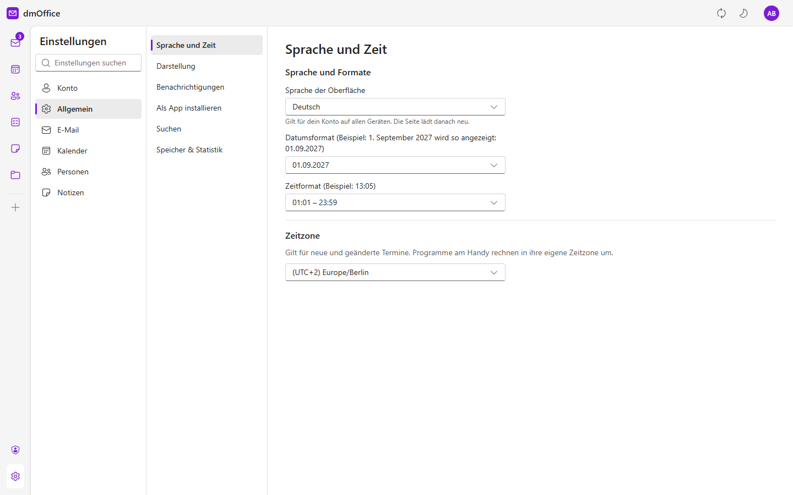

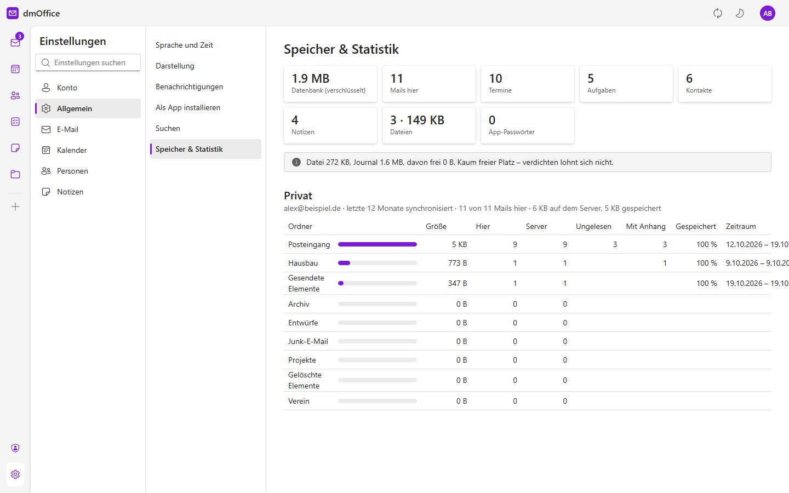

### Aktivität

dmOffice erledigt vieles im Hintergrund: E-Mails abgleichen, den Postausgang senden, Dateiinhalte aus der Datenbank auslagern, Prüfsummen berechnen, den Volltextindex aufbauen und Text erkennen, Vorschaubilder erzeugen, Notizen mit notizi abgleichen, Kalender-Abos abrufen, aufräumen und verdichten. Die Aktivitätsanzeige in der Titelleiste zeigt, wann etwas läuft; *Einstellungen* → *Aktivität* listet jede Aufgabe mit Zustand (läuft, wartet, zuletzt) und Fortschritt. Man muss dort nichts tun – es erklärt nur, warum der Server nach einem großen Import eine Weile beschäftigt ist.

---

## 13. Sicherheit

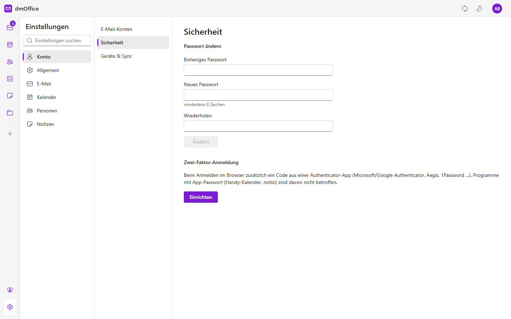

- **Verschlüsselt:** Jeder Benutzer hat eine eigene, verschlüsselte Datenbank (SQLCipher) mit eigenem Schlüssel, und jede gespeicherte Datei ist einzeln verschlüsselt. Wer nur das Datenverzeichnis kopiert, kann nichts lesen.
- **Zwei-Faktor-Anmeldung (TOTP):** *Einstellungen* → *Sicherheit* → *Einrichten*, QR-Code mit einer Authenticator-App scannen (Aegis, 2FAS, Google/Microsoft Authenticator …). Die **Wiederherstellungscodes** ausdrucken oder im Passwortmanager ablegen – jeder gilt einmal.
- **Passwort ändern** meldet alle anderen Sitzungen ab.
- Nach mehreren falschen Versuchen wartet dmOffice, bevor es weitere Anmeldungen annimmt – je Adresse und je Anmeldename.

---

## 14. Verwaltung (Admin)

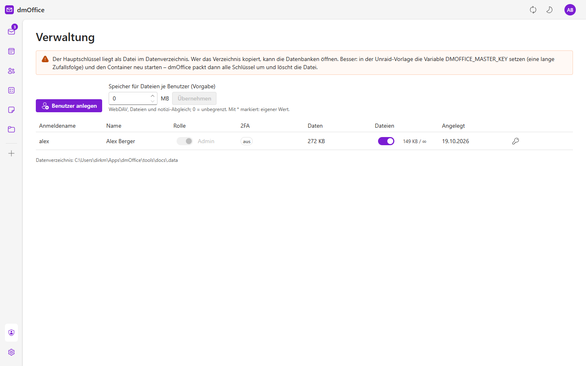

Nur für Benutzer mit Verwaltungsrecht:

- Benutzer anlegen, Passwort setzen, Verwaltungsrecht geben oder nehmen, löschen (mit Bestätigung durch den Anmeldenamen).
- **2FA zurücksetzen**, wenn jemand Handy und Wiederherstellungscodes verloren hat.
- **Speicher für Dateien:** eine Vorgabe für alle (0 = unbegrenzt) und je Benutzer ein eigener Wert (Klick auf die Spalte *Dateien*; leer lassen = Vorgabe). Die Grenze gilt für WebDAV, die Dateien-Ansicht und den notizi-Abgleich. Obergrenzen für frühere Versionen, Papierkorb und Freigabelinks gelten für alle.
- **Office im Browser:** Adresse des Office-Servers (und das JWT-Geheimnis bei ONLYOFFICE); *Prüfen und speichern* meldet, was nicht stimmt. Siehe [Abschnitt 9](#9-office-dateien-im-browser-bearbeiten).
- Ein Hinweis erscheint, solange der Hauptschlüssel als Datei im Datenverzeichnis liegt statt in `DMOFFICE_MASTER_KEY`.

---

## 15. Sicherung und Umzug

- **Sichern:** das Datenverzeichnis (`/data`, bei Unraid `appdata/dmoffice`), bei eigenem Ort auch den Ordner aus `DMOFFICE_BLOBS` (Inhalte der Dateiablage, gehört zur Datenbank – nur beide zusammen sind vollständig), **und** den Hauptschlüssel. Am sichersten bei gestopptem Container; im laufenden Betrieb vorher *Einstellungen* → *Speicher & Statistik* → *Datenbank verdichten* hilft, die Zwischendateien klein zu halten.
- **Dateiinhalte auf einem eigenen Volume:** In der Unraid-Vorlage unter *File contents* einen Ordner auf dem Array eintragen (etwa `/mnt/user/dmoffice-dateien`) und `DMOFFICE_BLOBS` auf `/blobs` setzen. Ohne Angabe liegen die Inhalte unter `blobs/` im Datenverzeichnis. Beim Wechsel den Container stoppen und den Ordner `blobs` mitnehmen.
- **Umziehen:** Datenverzeichnis auf den neuen Host kopieren, Container mit demselben `DMOFFICE_MASTER_KEY` starten.
- **Von Nextcloud:** Kalender als `.ics`, Adressbücher als `.vcf` exportieren und in dmOffice importieren; notizi auf allen Geräten auf die neue WebDAV-Adresse umstellen.

---

## 16. Tastenkürzel

| Taste | Wirkung |
|---|---|
| Strg+N | Neue E-Mail |
| Strg+R / Strg+Umschalt+R | Antworten / Allen antworten |
| Strg+Umschalt+F | Weiterleiten |
| Strg+Q / Strg+U | Als gelesen / ungelesen markieren |
| Einfg | Kennzeichnen |
| Entf | Löschen |
| ↑ / ↓ | Vorige / nächste Mail |
| Strg+Enter | Senden (beim Verfassen) |
| Strg+S | Notiz sofort speichern |
| Strg+X / C / V, Strg+Z | Ausschneiden / Kopieren / Einfügen / Rückgängig (in Dateien) |

---

## 17. Häufige Fragen

**Kopieren in die Zwischenablage oder Desktop-Benachrichtigungen gehen nicht.**
Browser erlauben das nur über HTTPS. dmOffice über den Reverse-Proxy mit Zertifikat aufrufen.

**Das Handy meldet „Anmeldung fehlgeschlagen“.**
Für Geräte gilt nur ein **App-Passwort**, nicht das Login-Passwort.

**Die Datenbank ist sehr groß.**
*Einstellungen* → *Speicher & Statistik* zeigt, welche Ordner wie viel belegen. Den Zeitraum der Synchronisation je Konto verkürzen und danach *Datenbank verdichten*.

**Die Dateiablage ist voll.**
Unter *Einstellungen* → *Dateien* nachsehen: Frühere Versionen und der Papierkorb zählen zum Speicher. Papierkorb leeren oder alte Versionen löschen.

**Ich habe den Hauptschlüssel verloren.**
Dann lassen sich die Datenbanken nicht mehr öffnen. Mails liegen weiter auf dem Mailserver; Kalender, Kontakte, Notizen und Dateien nur noch auf den verbundenen Geräten.
