# dmOffice – Manual

[Deutsch](handbuch.md) · **English** · Website with news and guides (German): [dmoffice.de](https://dmoffice.de)

dmOffice is a self-hosted office in your browser: email, calendar, contacts, tasks, notes and files in one interface. It also includes its own CalDAV, CardDAV and WebDAV service, so your phone, tablet and Thunderbird fetch their data straight from dmOffice. An Android app and the option to edit Word, Excel and PowerPoint files in the browser complete it.

The pictures show a fictional sample account (“Alex Berger”). They are regenerated from an empty database with `tools/docs/make.sh`.

**Contents**

1. [Installation and first start](#1-installation-and-first-start)
2. [Email](#2-email)
3. [Calendar](#3-calendar)
4. [Contacts](#4-contacts)
5. [Tasks](#5-tasks)
6. [Notes](#6-notes)
7. [Files](#7-files)
8. [Sharing with other users](#8-sharing-with-other-users)
9. [Editing Office files in the browser](#9-editing-office-files-in-the-browser)
10. [Android app](#10-android-app)
11. [Connecting your phone, tablet and Thunderbird](#11-connecting-your-phone-tablet-and-thunderbird)
12. [Settings](#12-settings)
13. [Security](#13-security)
14. [Administration (Admin)](#14-administration-admin)
15. [Backup and moving](#15-backup-and-moving)
16. [Keyboard shortcuts](#16-keyboard-shortcuts)
17. [Frequently asked questions](#17-frequently-asked-questions)

---

## 1. Installation and first start

dmOffice runs as a Docker container. It is meant for Unraid but works on any Docker host.

**Unraid**

1. Search for **dmOffice** under *Apps* and install it. If the app is not listed there yet, see the [README](../README.md#unraid).
2. In the template, set **DMOFFICE_MASTER_KEY** – a long random string, e.g. from `openssl rand -hex 32`. Keep this key safe (password manager): **without it, your data can no longer be opened.**
3. Choose a port and click *Apply*.

**Docker Compose**

```yaml
services:
  dmoffice:
    image: ghcr.io/taloan/dmoffice:latest
    ports: ["8080:8080"]
    volumes: ["./data:/data"]
    environment:
      DMOFFICE_MASTER_KEY: "<long random string>"
      TZ: Europe/Berlin
    restart: unless-stopped
```

All environment variables (`DMOFFICE_BLOBS`, `DMOFFICE_MS_CLIENT_ID`, `DMOFFICE_TRUSTED_PROXIES` …) are listed in the [README](../README.md#configuration).

**First visit:** open `http://<server>:8080/`. On the very first visit, dmOffice creates the admin account. After that, you sign in with your username and password.

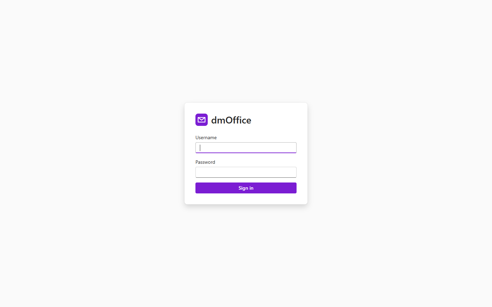

For access on the move and for phones, dmOffice should sit behind a reverse proxy with HTTPS (Nginx Proxy Manager, SWAG, Traefik). Some browser features (clipboard, desktop notifications, installing as an app) are only available over HTTPS.

**Install as an app (PWA):** *Settings* → *General* → *Install as PWA* (Chrome, Edge, Android) or, on iPhone/iPad, Safari’s *Share* → *Add to Home Screen*. dmOffice then runs in its own window with its own icon.

---

## 2. Email

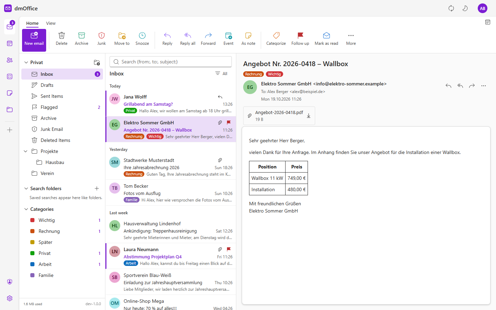

On the left are the **Favourites** and the folders of each account, in the middle the message list, and on the right the reading pane and – if turned on – the **To Do bar** with Calendar, People and Tasks.

### Setting up an account

*Settings* → *Account* → *Email accounts* → *Add account*. Enter the address: dmOffice finds servers, ports and the sign-in method by itself; otherwise enter the IMAP and SMTP servers. Check the settings with *Test connection*. Outlook.com, Hotmail and Live accounts sign in with Microsoft (see the [README](../README.md#outlookcom-hotmail-and-live)).

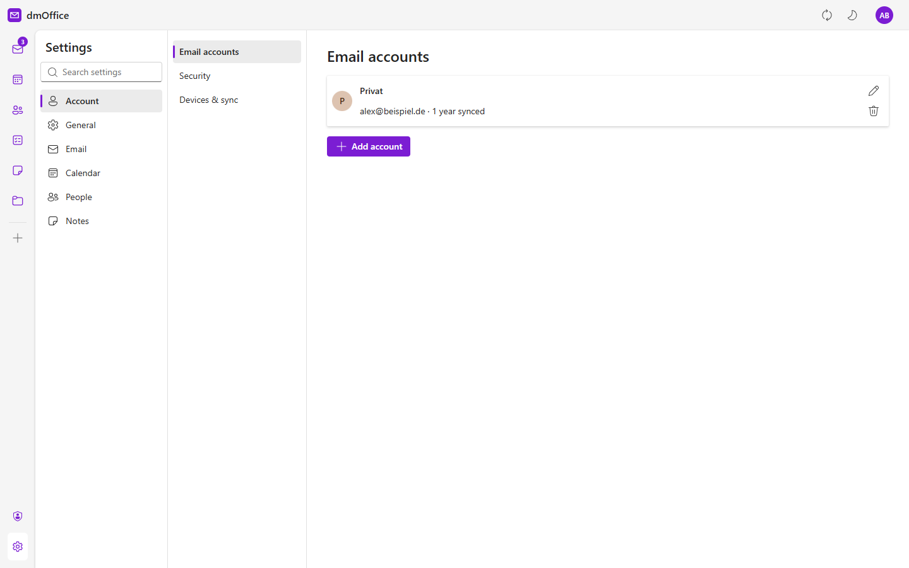

For each account you can set:

| Setting | Meaning |
|---|---|
| **Period** | *All* or only the last few months are kept offline in dmOffice and are searchable. |
| **Fully store messages up to this size (MB)** | Smaller messages are stored in the database together with their attachments; larger ones are fetched when you open them. |
| **Save sent messages in "Sent Items"** | Off for Gmail – Gmail files the copy itself. |
| **Mail language** | German or English: determines *AW:/Re:*, *WG:/Fwd:*, the quote header and the spell check when replying. |
| **Signature** | Placed below the text when you compose. |

### Reading, sorting, filing

- **Dragging** messages onto a folder moves them; dragging them onto *Flagged* flags them.
- **Right-clicking** one or more messages opens the context menu with all actions.
- **Pictures from the internet** are blocked because they tell the sender that the message has been read. With *Show pictures ▾* you can allow them once, or permanently for the sender or the whole domain.
- **Search** at the top of the list: plain words, or targeted with `von:` (from), `an:` (to), `betreff:` (subject). With *All accounts* you search across all accounts.
- **Filter** above the list: Unread, Flagged, With attachments, or a category.

### Categories

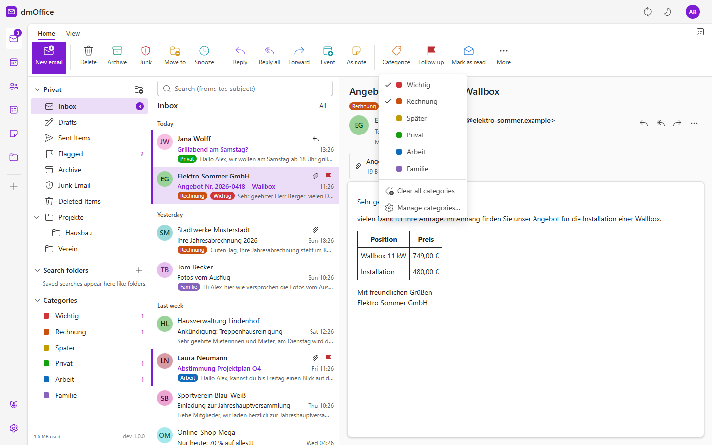

Categories are coloured keywords for messages. dmOffice stores them as an **IMAP keyword** on the mail server – so they are also visible in Thunderbird or on a second dmOffice, as long as the same keyword is used there.

- *Categorize ▾* in the ribbon or in the right-click menu.
- Manage them under *Settings* → *Mail* → *Categories*: name, colour, order. Renaming only changes the display; the messages keep their category.
- Gmail does not accept custom keywords; dmOffice reports this.

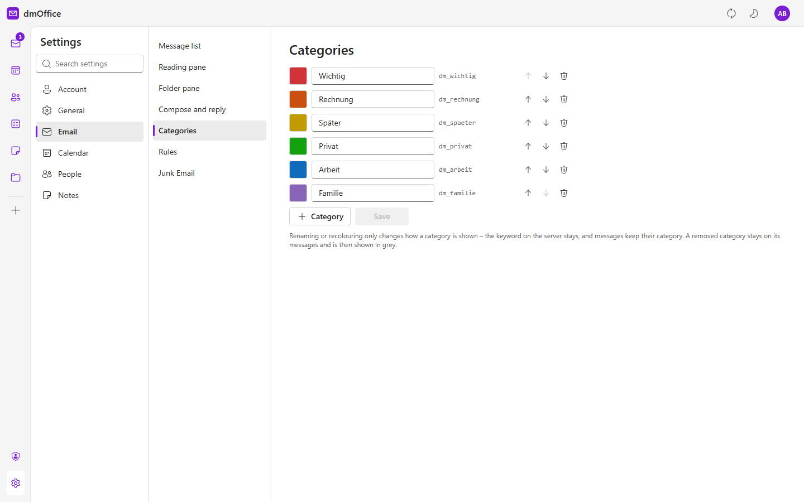

### Snooze

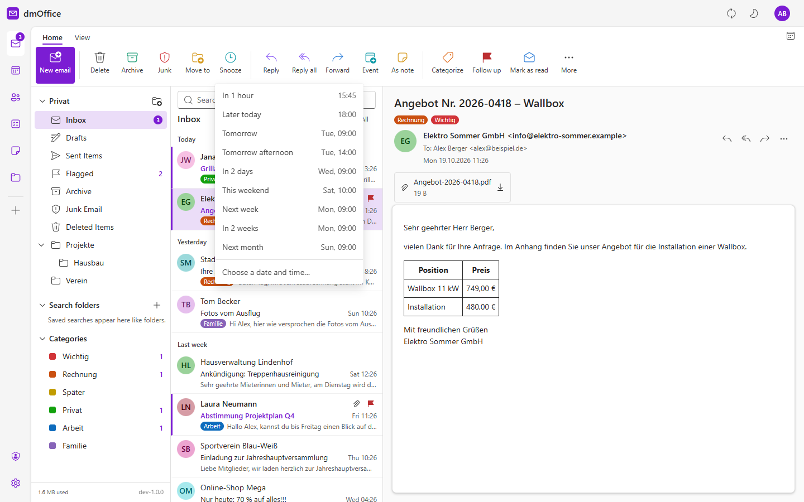

Put a message aside for later: *Snooze* → *In 1 hour*, *This evening*, *Tomorrow*, *Next week* … or a date of your own. The message disappears into the *Snooze* folder and reappears at the chosen time **unread at the top of the Inbox**. With *Unsnooze* it comes back immediately.

### Writing

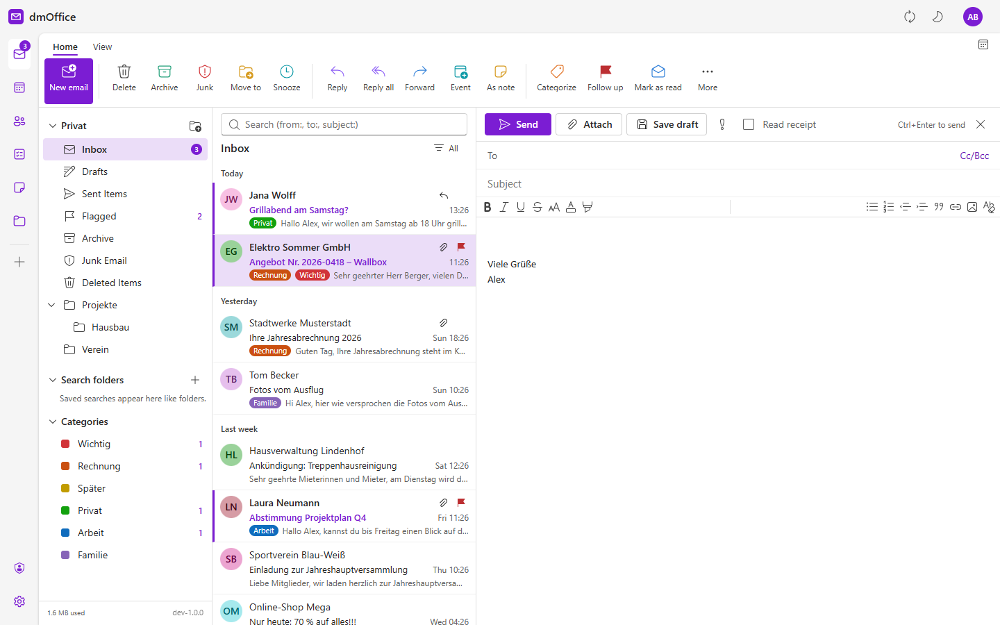

- *New email*, *Reply*, *Reply all*, *Forward* or *Forward as attachment*.
- Recipients are suggested from contacts and earlier addresses as you type. An earlier suggestion can be forgotten with **×**; manage the list under *Settings* → *People*.
- Drafts are saved automatically. **Ctrl+Enter** sends.
- If the text mentions an attachment but none is attached, dmOffice asks.

### Doing more with a message

- **Create event from email** – creates an event with the subject and text of the message.
- **Save as note** – copies the message into your notes. At the top of the note is a link, *Mail in dmOffice öffnen*, that opens the message again – even if it has since been moved to another folder.
- **Invitations** – a meeting invitation in a message can be accepted, tentatively accepted or declined right in the message. Accepted events go into the calendar chosen under *Settings* → *Calendar* → *Invitations*; if the event is already in another calendar, it stays there.

### Rules

*Settings* → *Mail* → *Rules*. A rule checks new messages in the Inbox (sender, recipient, subject, body, header) and can move, copy, forward, mark as read, flag, assign a category or delete. Every message runs through the rules **once** – even if it later lands in the Inbox again.

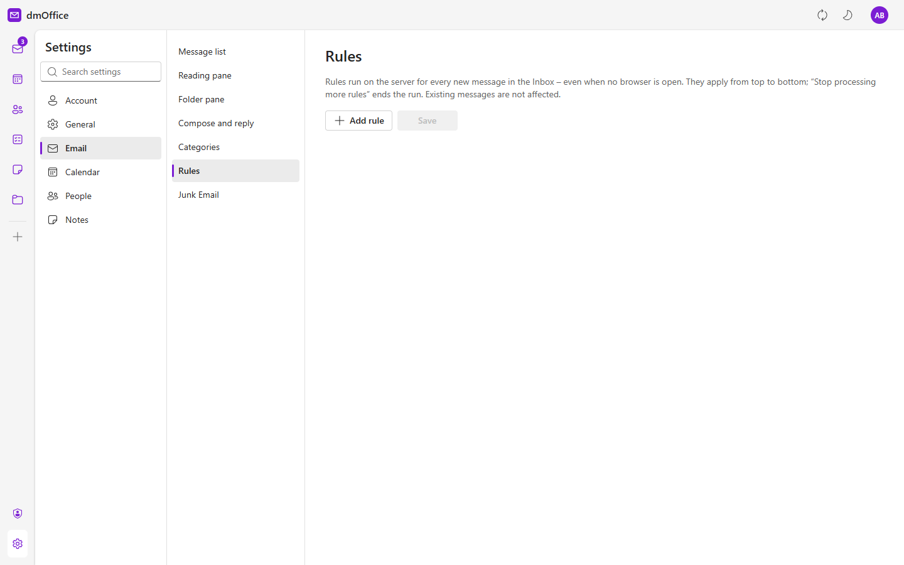

### Junk email

The junk filter uses a statistical method to learn from what you mark as *Junk* or *Not junk*. It only scores and moves messages once it has learned 10 of each kind; until then everything stays in the inbox. *Learn from folders* gets it there faster. Contacts and recipients of your sent mail count as safe senders and never land in Junk. Settings and thresholds are under *Settings* → *Mail* → *Junk email*.

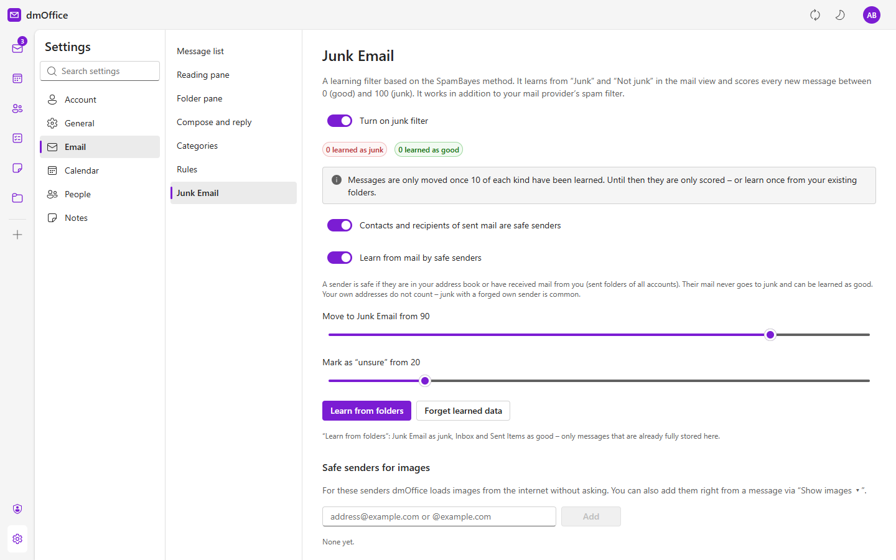

### Light and dark

The moon at the top right switches between light, dark and the system setting.

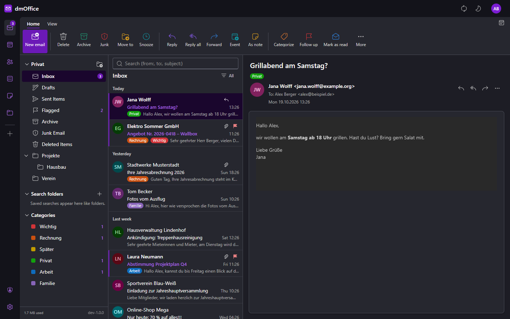

---

## 3. Calendar

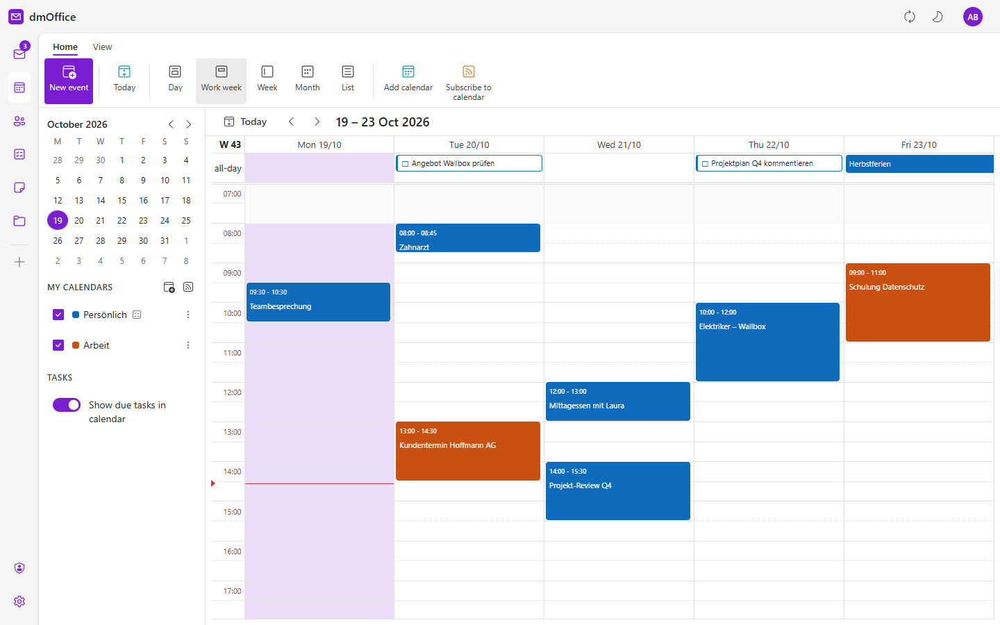

- Views: Day, Work week, Week, Month, List.
- Several coloured calendars, each of which can be shown or hidden individually.
- **Recurring events**: daily, weekdays, weekly, every two weeks, monthly, yearly. When you make a change, dmOffice asks whether you mean just this event or the whole series. If you move the whole series, cancelled and changed individual occurrences move with it.
- **Reminders** appear as a notification in the browser (allow notifications) and on all connected devices.
- **Import/export** as `.ics` via the calendar’s menu – this is how calendars move over from other programs.
- If an event is changed on your phone at the same time, dmOffice warns you when you save instead of overwriting the change.

### Inviting attendees

In the event editor, *Invite attendees* takes addresses or names from your contacts. The invitation goes out by email from one of your mail accounts – also to addresses outside dmOffice – and replies update the event. If you change the event you can notify the attendees about it; deleting it sends them a cancellation. Without a mail account, attendees are saved but not notified.

### Subscribing to calendars

*Subscribe to calendar* in the calendar list takes a `webcal://` or `https://` address (usually ending in `.ics`) – for example waste collection, public holidays, school holidays or a shared calendar from another provider. A subscription is read-only, is refreshed regularly (hourly up to weekly, your choice; *Refresh now* from the calendar’s menu) and also appears on connected devices.

### Calendar types and the meal plan

Every calendar has a **type**, set in its properties. Besides *Regular calendar* there is *Meal plan*. Meal plan calendars do not show in the normal calendar views; they appear in their own **Meal plan** view (ribbon): a week with breakfast, lunch and dinner per day, built from all enabled meal plan calendars, each entry in the colour of its calendar. Type what is on the menu, or pick a recipe from your notes (notes that use the notizi recipe template). *Ingredients to shopping list* copies the ticked ingredients of the week’s recipes to a task list. Share a meal plan calendar with your family (see [section 8](#8-sharing-with-other-users)) and everyone plans in the same week.

---

## 4. Contacts

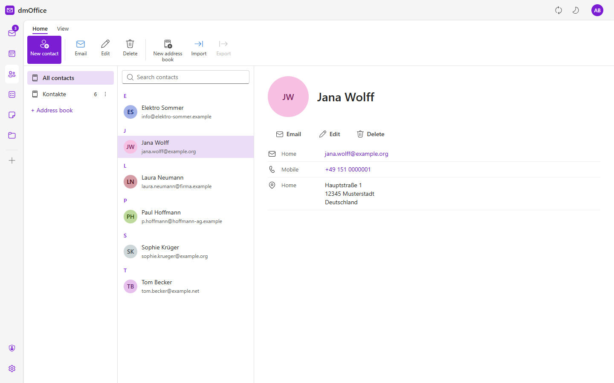

Address books with photos, several phone numbers, addresses and birthdays. Fields that dmOffice does not edit itself (e.g. PO box or additional phone types from the iPhone) are preserved when you save. Import and export as `.vcf`.

---

## 5. Tasks

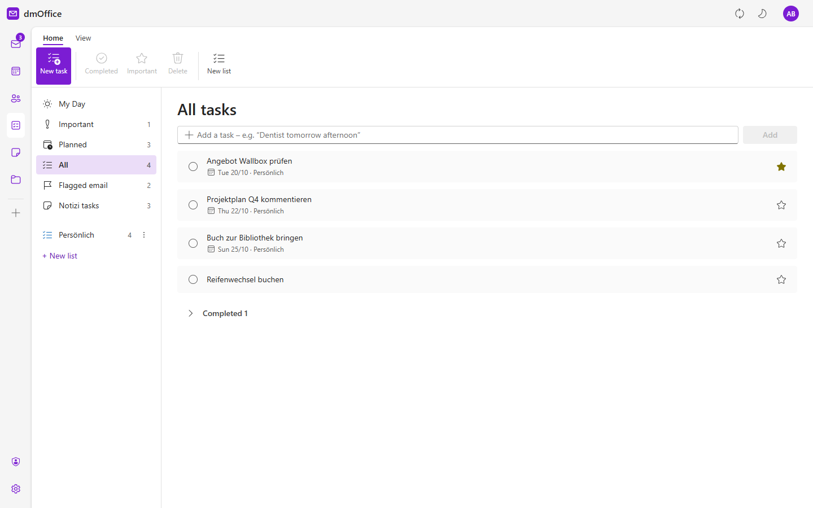

*My Day*, *Important*, *Planned* and your own lists. Tasks are VTODO entries in a calendar and therefore show up in any tasks app that supports CalDAV (e.g. jtx Board, OpenTasks, Reminders on the iPhone). Date and time are recognised from the text: “Dentist tomorrow afternoon” becomes a task due tomorrow afternoon. Lists can be shared with other users (see [section 8](#8-sharing-with-other-users)); a shopping list shared with the family is a typical use.

---

## 6. Notes

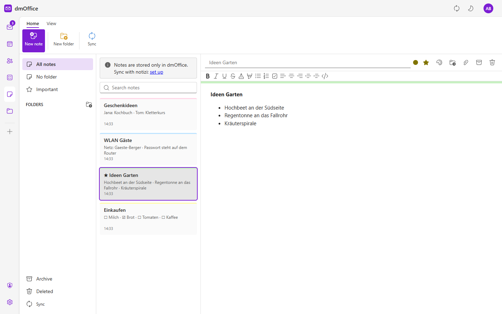

Notes with colour, folders, a star for *Important*, checkboxes to tick off, lists, code blocks and attachments. Pictures from the clipboard or dragged in land directly in the text; other files become attachments. Links open with Ctrl+click.

**With notizi:** dmOffice is one more device for the notes from **notizi**. Syncing runs through notizi’s end-to-end encrypted sync folder, which lives in dmOffice’s WebDAV. Set it up under *Settings* → *Notes*: enter the E2EE password and choose the database.

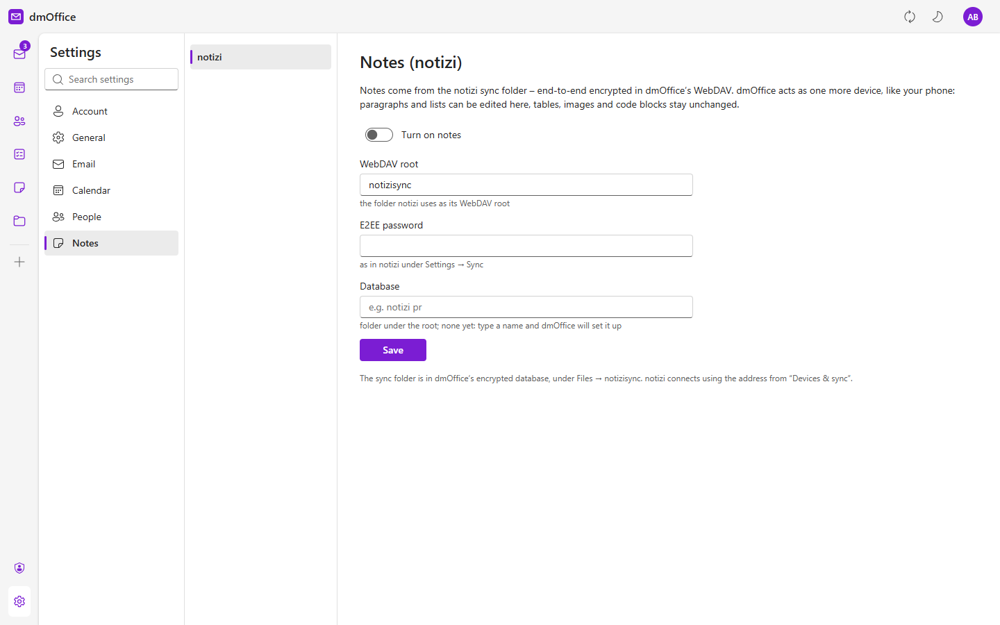

Tables and pictures from notizi are displayed but can only be edited in notizi on the PC – they are locked in dmOffice. If another device changes a note while it is open in dmOffice, dmOffice warns you and offers *Save as copy*.

Without notizi the notes work just the same, only without syncing. Note folders can be shared with other users (see [section 8](#8-sharing-with-other-users)).

---

## 7. Files

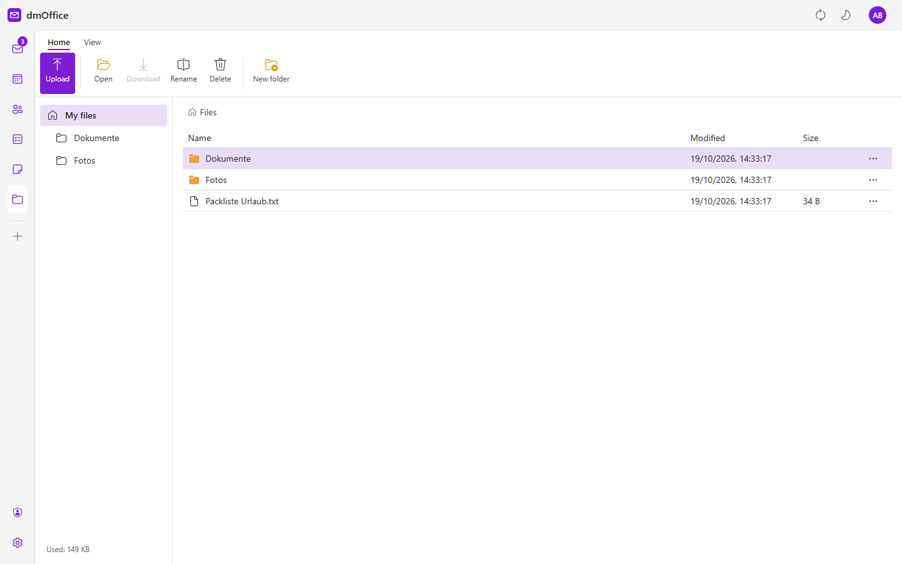

Your own file storage – in the browser and via WebDAV (Windows Explorer, Finder, file managers on your phone). Every file is stored encrypted on its own.

**Working with files**

- Upload with the button or by dragging, including whole folders. Folders can be downloaded as a ZIP.
- Views: list or tiles, sorted by name, size, date or type, optionally grouped; a details pane shows the properties of the selection, including its checksum (click to copy).
- Left: *Recent*, *Favourites*, *Photos*, *Shared by me*, *Shared with me* and the recycle bin. At the bottom you see how much is used; if the admin has set a limit, a bar shows how much of it is in use.
- Cut, copy and paste with Ctrl+X/C/V, rename, delete, and **Undo** for the last action. If a name already exists at the destination, dmOffice asks: *Replace*, *Keep both* or *Skip* – for all remaining conflicts at once if you like.
- **Preview:** pictures, PDFs, audio, video, text and Markdown open in a viewer; text and Markdown files can be edited right there. Thumbnails are created in the background.
- **Search** looks at names and – once indexed – at the **contents** of documents, PDFs and, with text recognition (OCR), scans and photos. Search in the current folder or everywhere, and filter by type (picture, document, spreadsheet, presentation, audio, video).

### Recycle bin

Deleted files and folders go to the recycle bin and can be restored (with their original location shown) until it is emptied. In *Settings* → *Files* → *Recycle bin* you choose after how many days items are removed automatically (default 30; or never) and an optional storage limit; when the limit is reached, the items deleted longest ago go first.

### Previous versions

When a file is overwritten – in the browser, via WebDAV, from the phone or in the office editor – the old content is kept as a **previous version**. Select the file and open *Previous versions* in the details pane to restore one (the current content then becomes a version itself). *Settings* → *Files* → *Previous versions* offers three modes: thin out automatically (one version per hour for the last 24 hours, one per day for the last 30 days, then one per week), a fixed number per file, or none; plus a storage limit for all versions. When space runs out, the oldest versions give way first, then the recycle bin. The admin can set upper limits for everyone.

### Sharing links

*Share* in the context menu creates a link that anyone can open without signing in. You decide what visitors may do – view, view and download, view and upload, or **upload only** into a drop box whose contents stay hidden – and can add an **expiry date**, a **password** and a limit on downloads. *Shared by me* lists all your shares; links can be revoked at any time. Defaults for new links are set in *Settings* → *Files* → *Sharing links*. To share folders with other users of the same server instead, see the next section.

### Checksums and duplicates

dmOffice records a SHA-256 checksum of every file’s contents. The Android app uses it to recognise what is already backed up, wherever it is stored. See [duplikate.md](duplikate.md).

---

## 8. Sharing with other users

Calendars, task lists, note folders and file folders can be shared with other users of the same server. The owner chooses per person whether they may **view** or **edit**, and can change or withdraw this at any time.

- **Calendars and task lists:** *Share…* in the context menu of the list. Recipients find them under *Shared with me*. With *Edit* they can add, tick off and change entries; read-only calendars are marked as such.
- **Note folders:** *Share with people* on the folder (including its subfolders). Changes are visible to everyone immediately.
- **File folders:** *Share* → *Share with people* (above the link section). Recipients get a virtual folder *Shared with me* at the top of their files – also visible in WebDAV and Nextcloud clients. Only folders can be shared this way; share single files with a link.
- Recipients can hide a share (*Stop showing*); the owner can share it again.

The shared content **stays with its owner**: nothing is copied and no keys are handed out, the server checks the permission on every request, so withdrawing access takes effect at once. Deleted files and previous versions of a shared folder go to the owner’s recycle bin, and uploads count against the owner’s storage. Details and limits: [geteilte-kalender.md](geteilte-kalender.md), [geteilte-notizen.md](geteilte-notizen.md), [geteilte-ordner.md](geteilte-ordner.md).

---

## 9. Editing Office files in the browser

With an office server of your own, Word, Excel and PowerPoint files (DOCX, XLSX, PPTX, also ODT, ODS, ODP, RTF) open for editing straight from *Files*: double-click, or *Edit in browser* in the context menu; *New* → *Word document / Excel workbook / PowerPoint presentation* creates an empty file and opens it. Saving goes through the file storage, so previous versions, recycle bin, search and storage limits apply as usual. Several people can work in the same document, also in shared folders (with *Edit* permission).

The admin connects the office server under *Admin* → *Office in the browser*. **Collabora Online (CODE)** is recommended and also works on phones; an existing **ONLYOFFICE Docs** server works too. Setup, reverse-proxy examples and troubleshooting: [office.md](office.md). Without an office server, the file storage works as before.

---

## 10. Android app

The native Android app (Android 8 and newer) brings dmOffice to your phone. It is not in the Play Store but available as a signed APK in the [GitHub releases](https://github.com/Taloan/dmOffice/releases) – open *Settings* → *General* → *Install apps* in dmOffice for the download and the steps. The app checks for updates itself (from GitHub, once a day and at start; the signature must match) and offers them to install.

**Setting up:** in dmOffice, *Settings* → *Account* → *Devices & sync* → *Pair phone app* shows a QR code (it contains a new app password and is displayed only once). Scan it in the app, or enter address, username and app password by hand. Traffic between app and server is additionally wrapped in an encrypted envelope on top of TLS.

**What it does**

- **Calendar and tasks** with agenda, day, week and month views, offline, with reminders and three home screen **widgets** (agenda, tasks, month). Date and time are recognised from the text (“Dentist tomorrow 3pm”).
- **Mail** with offline cache, reading, replying, forwarding and notifications for new mail, set per account. **Contacts** and **notes**.
- **Files:** browse, search, preview, rename, delete, restore previous versions and create share links. Mark files or folders **Available offline** to keep a copy on the phone that stays in sync. Office files open in the editor of your office server.
- **Auto upload:** rules upload new photos, videos or other files from a folder on the phone (camera, screenshots, WhatsApp media or any folder) into a folder of your dmOffice files, optionally sorted into subfolders by year, month or day. Per rule you set the file types, what happens with files of the same name (keep both, skip, replace – the old file is kept as a previous version), whether to upload only on Wi-Fi, while charging or when roaming, and from which date on. New photos are noticed within seconds; a file whose contents already exist anywhere in dmOffice (same checksum, also from another device) is not transferred again. An upload queue shows progress, and failed uploads can be retried.
- **Free up space:** lists photos and videos that dmOffice has confirmed as backed up (by checksum, and unchanged since) and deletes them from the phone on request. Right before deleting, the app asks the server once more; in dmOffice the files stay. You can keep recent days on the phone.
- **Android calendar and contacts:** optionally mirrored into the phone’s own calendar and contacts so that other apps see them.
- **Security:** encrypted local database, optional app lock with fingerprint, face or PIN.

Technical details, the build and optional push notifications: [apps/mobile/README.md](../apps/mobile/README.md).

---

## 11. Connecting your phone, tablet and Thunderbird

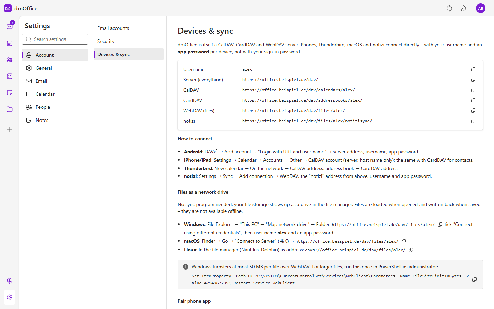

Under *Settings* → *Account* → *Devices & sync*, create **a separate app password for each device**. The login password deliberately does not work for these programs: an app password can be revoked individually if a device is lost.

| Program | How |
|---|---|
| **Android (DAVx⁵)** | *Login with URL and user name*, URL `https://<host>/dav/`, username, app password. |
| **iPhone/iPad** | *Settings* → *Calendar* → *Accounts* → *Add Account* → *Other* → *Add CalDAV Account*; server: the host name only. For contacts do the same with *CardDAV account*. |
| **Thunderbird** | New calendar → *On the network* → address from *Devices & sync*. Address book: *Add CardDAV address book*. |
| **Windows Explorer** | *Map network drive* → `https://<host>/dav/files/<login>/` (HTTPS only). |
| **notizi** | *Settings* → *Sync* → *WebDAV*, address `https://<host>/dav/files/<login>/notizisync/`. |
| **Nextcloud clients** | Desktop and mobile clients work too, see [nextcloud-clients.md](nextcloud-clients.md). |

---

## 12. Settings

Settings are laid out in areas: the area on the left, the page in the middle, the content on the right. At the top left there is a search across all pages.

| Page | Contents |
|---|---|
| **Language and time** | Display language (German/English, applies to the account on all devices), date and time format, time zone |
| **Appearance** | Light/dark, accent colour, text size |
| **Notifications** | Alerts for new mail and reminders, also as desktop notifications |
| **Message list** | Spacing, preview text, sender pictures |
| **Reading pane** | Reading pane on the right, at the bottom or off; when a message counts as read |
| **Folder pane** | Favourites, sorting |
| **Compose and reply** | Font and size, default *Reply* or *Reply all* |
| **Files** | Storage used, previous versions, recycle bin and defaults for sharing links |
| **Storage & statistics** | Size of the folders and the database, compact database |
| **Activity** | What is running in the background – see below |

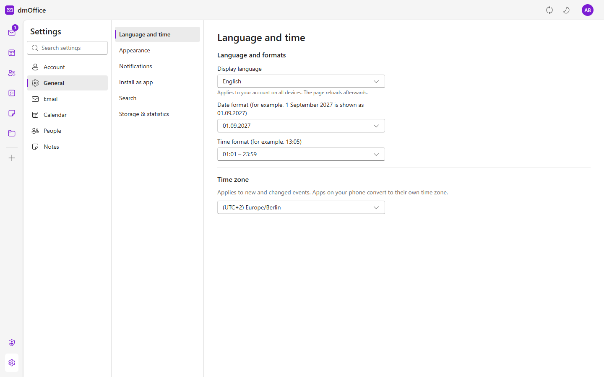

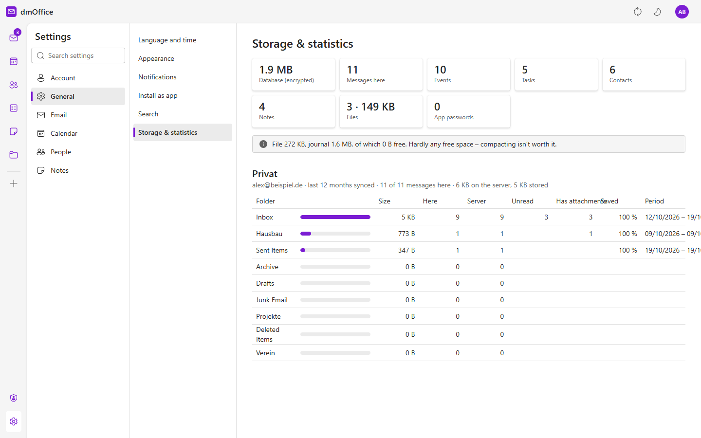

### Activity

dmOffice does a lot of work in the background: syncing mail, sending the outbox, moving file contents out of the database, computing checksums, building the full-text index and recognising text, creating thumbnails, syncing notes with notizi, fetching calendar subscriptions, cleaning up and compacting. The activity indicator in the title bar shows when something is running; *Settings* → *Activity* lists every job with its state (running, waiting, last run) and progress. Nothing needs to be done there – it only explains why the server is busy for a while after a big import.

---

## 13. Security

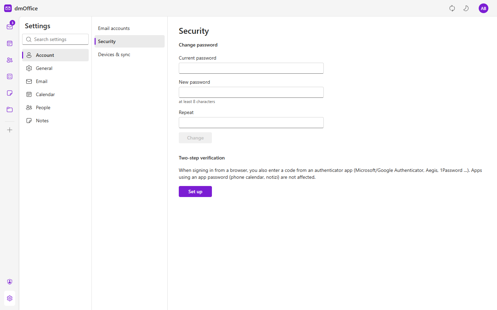

- **Encrypted:** Each user has their own encrypted database (SQLCipher) with its own key, and every stored file is encrypted on its own. Anyone who merely copies the data directory cannot read anything.
- **Two-step verification (TOTP):** *Settings* → *Security* → *Set up*, scan the QR code with an authenticator app (Aegis, 2FAS, Google/Microsoft Authenticator …). Print the **recovery codes** or store them in your password manager – each one works once.
- **Change password** signs out all other sessions.
- After several wrong attempts, dmOffice waits before accepting further sign-ins – per address and per username.

---

## 14. Administration (Admin)

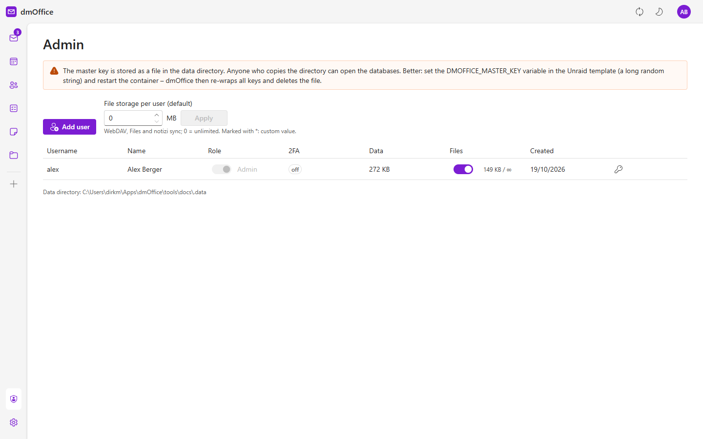

Only for users with admin access:

- Create users, set passwords, grant or revoke admin access, delete (confirmed by typing the username).
- **Reset 2FA** if someone has lost their phone and recovery codes.
- **File storage:** a default for everyone (0 = unlimited) and a separate value per user (click the *Files* column; leave blank = default). The limit applies to WebDAV, the Files view and the notizi sync. Upper limits for previous versions, recycle bin and sharing links apply to everyone.
- **Office in the browser:** address of the office server (and the JWT secret for ONLYOFFICE); *Check and save* tells you what is wrong, if anything. See [section 9](#9-editing-office-files-in-the-browser).
- A notice is shown as long as the master key is stored as a file in the data directory instead of in `DMOFFICE_MASTER_KEY`.

---

## 15. Backup and moving

- **Backing up:** the data directory (`/data`, on Unraid `appdata/dmoffice`), with a separate location also the folder from `DMOFFICE_BLOBS` (the contents of the file storage, it belongs to the database – only both together are complete), **and** the master key. It is safest with the container stopped; while it is running, first using *Settings* → *Storage & statistics* → *Compact database* helps keep the intermediate files small.
- **File contents on a separate volume:** in the Unraid template, enter a folder on the array under *File contents* (e.g. `/mnt/user/dmoffice-files`) and set `DMOFFICE_BLOBS` to `/blobs`. Without it the contents live in `blobs/` inside the data directory. When switching, stop the container and take the `blobs` folder along.
- **Moving:** copy the data directory to the new host and start the container with the same `DMOFFICE_MASTER_KEY`.
- **From Nextcloud:** export calendars as `.ics` and address books as `.vcf` and import them into dmOffice; switch notizi on all devices to the new WebDAV address.

---

## 16. Keyboard shortcuts

| Key | Action |
|---|---|
| Ctrl+N | New email |
| Ctrl+R / Ctrl+Shift+R | Reply / Reply all |
| Ctrl+Shift+F | Forward |
| Ctrl+Q / Ctrl+U | Mark as read / unread |
| Ins | Flag |
| Del | Delete |
| ↑ / ↓ | Previous / next message |
| Ctrl+Enter | Send (when composing) |
| Ctrl+S | Save note immediately |
| Ctrl+X / C / V, Ctrl+Z | Cut / copy / paste / undo (in Files) |

---

## 17. Frequently asked questions

**Copying to the clipboard or desktop notifications do not work.**
Browsers only allow this over HTTPS. Open dmOffice through the reverse proxy with a certificate.

**My phone says “Login failed”.**
Devices only accept an **app password**, not the login password.

**The database is very large.**
*Settings* → *Storage & statistics* shows which folders take up how much. Shorten the sync period for each account and then use *Compact database*.

**The file storage is full.**
Check *Settings* → *Files*: previous versions and the recycle bin count towards the storage. Empty the recycle bin or delete old versions.

**I have lost the master key.**
Then the databases can no longer be opened. Messages remain on the mail server; calendars, contacts, notes and files only on the connected devices.
